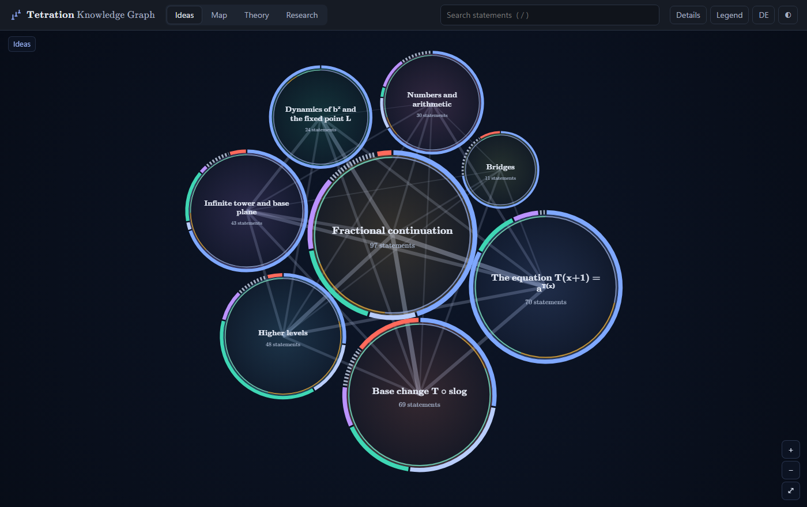

# Tetration-Wissensgraph

**Eine überprüfbare Landkarte dessen, was über die Tetration bekannt ist** — die Rechenart $a\uparrow\uparrow x$, „$a^{a^{\cdots}}$ mit $x$ Stockwerken“,
fortgesetzt auf reelle und komplexe Höhen — und ihrer Verbindungen zu Funktionalgleichungen, Iterationstheorie, komplexer Dynamik, Arithmetik und Logik.

**[Den Graphen öffnen](https://lightrunnerwastaken.github.io/tetration-graph/?lang=de)** · läuft im Browser, ohne Installation · English: [README.md](README.md)

[](https://lightrunnerwastaken.github.io/tetration-graph/?lang=de)

Jeder Eintrag ist eine einzelne mathematische **Aussage** mit Voraussetzungen, Beweis oder Beweislücken, Quellen und einem ausdrücklichen Status
(bewiesen · in der Literatur bewiesen · bedingt · numerisch · Vermutung · offen · widerlegt …). Das Prüfprogramm gibt den Status entlang der Beweisketten weiter:
Ein Satz, der auf einer unbewiesenen Annahme ruht, wird automatisch „bedingt“, und alles, was an einer widerlegten Aussage hängt, wird zum Nachprüfen markiert.
Zahlen stammen aus nachrechenbaren Experimenten; ihr Ergebnis gilt nur, solange der Hash des Skripts passt.

**Umfang:** etwa 390 Aussagen, 680 Kanten, 55 Experimente, 300 Quellen, 9 Gebiete, 8 Hauptideen. Massgeblich ist der Kopf von [`ausgabe/pruefbericht.md`](ausgabe/pruefbericht.md).

## Ansichten

- **Ideen** (Start): die Struktur des Gebiets als Netz aus acht Hauptideen; die Lage ergibt sich aus der Kopplung, Ringe zeigen, wie viel bewiesen ist und woher es stammt. Klick öffnet Unterideen und Aussagen.
- **Karte:** zoombare Karte nach Gebieten und Forschungssträngen.
- **Theorie:** ein Lehrbuch in 12 Kapiteln, mit einer ausführlichen Erklärung zu jeder Aussage.
- **Forschung:** offene Fragen, Lücken, Korrekturen, Experimente.
- Bei Vermutungen und bedingten Sätzen zeigt die Detailtafel, **woraus das Ergebnis besteht** und wo genau etwas fehlt.

Die Ansicht startet auf Englisch; der Knopf **DE/EN** schaltet um (die Wahl wird gemerkt).

## Aufbau und Bauen

Gearbeitet wird auf Deutsch, die englische Fassung wird mit eigenen Werkzeugen synchron gehalten. Aufbau, alle Feldnamen und der Weg zu einer neuen Aussage:
[docs/REPOSITORY_GUIDE.md](docs/REPOSITORY_GUIDE.md) (englisch).

```bash
pip install pyyaml pytest
python baue.py                     # prüfen + bauen → ausgabe/tetration-graph.html
python baue.py --nur-pruefen       # nur Prüfbericht
python -m pytest -q tests
```

## Mitmachen, Zitieren, Lizenz

Korrekturen, fehlende Literatur und neue Ergebnisse sind willkommen: [CONTRIBUTING.md](CONTRIBUTING.md). Zitieren über „Cite this repository“ auf GitHub ([CITATION.cff](CITATION.cff)).
Arbeitsverlauf: [docs/VERLAUF.md](docs/VERLAUF.md). Code MIT ([LICENSE](LICENSE)), Inhalte CC BY 4.0 ([LICENSE-INHALT.md](LICENSE-INHALT.md)).
