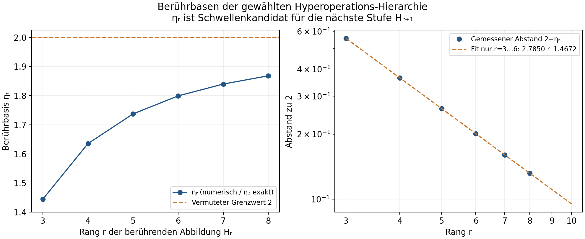
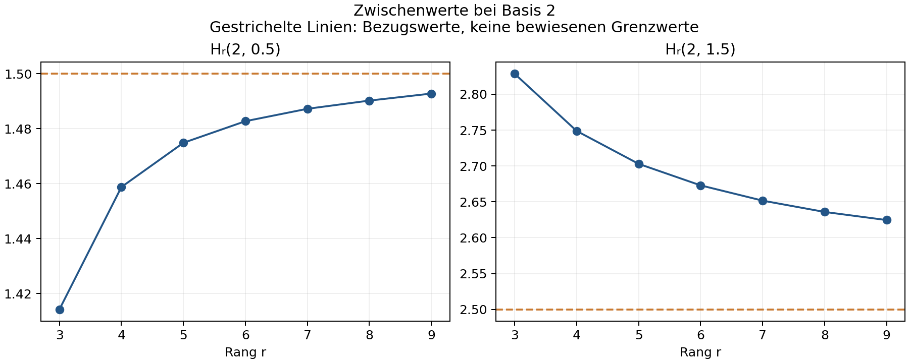

# Kritische Basen höherer Hyperoperationen

**Stand: 12.10.2026.** Eigenständige Untersuchung; das H₀-Projekt bleibt pausiert.

Die erinnerte Folge setzt sich für die untersuchte Fortsetzung numerisch fort:

\[
1.444667861010\to1.635324496715\to1.737355925152
\to1.799121236129\to\mathbf{1.839758660723}
\to\mathbf{1.868146577357}.
\]

Heptation, Octation und Nonation wurden aufgebaut. Für beschränkte reelle Decation funktioniert zusätzlich eine Koenigs-Konstruktion durch Rückwärtsiteration. Die Werte stützen die Vermutung einer Annäherung an 2. **Der Grenzwert genau 2 ist nicht bewiesen.** Die höheren Zahlen sind lokale positive Berührungen der gewählten Fortsetzungen; ihre globale Schwelleninterpretation benötigt die in [MATHEMATIK.md](MATHEMATIK.md) genannten Voraussetzungen.

## 1. Einheitliches H und die Indizierung von η

Wir verwenden H₃(b,x)=bˣ, H₄=Tetration, H₅=Pentation, H₆=Hexation, H₇=Heptation, H₈=Octation, H₉=Nonation und H₁₀=Decation. Für alle höheren Stufen gilt dieselbe Rekursion:

\[
H_{r+1}(b,0)=1,\qquad
H_{r+1}(b,x+1)=H_r\bigl(b,H_{r+1}(b,x)\bigr).
\]

ηᵣ bezeichnet die **Basis**, bei der die Abbildung Hᵣ die Diagonale berührt:

\[
H_r(\eta_r,e_r)=e_r,\qquad
\partial_xH_r(\eta_r,e_r)=1.
\]

eᵣ ist die zugehörige **Höhe**, nicht die Basis. Diese Berührung begrenzt unter den üblichen globalen Voraussetzungen die Beschränktheit der **nächsten** Hyperoperation Hᵣ₊₁. Daher ist e^(1/e) die Tetrationsgrenze, obwohl die berührende Abbildung H₃ die Exponentialfunktion ist. Alternativ kann man die Grenze nach der begrenzten Operation benennen: Eₛ:=ηₛ₋₁. Diese Unterscheidung verhindert den sonst naheliegenden Versatz um eine Stufe.

## 2. Die untersuchte Folge

| r | Berührende Abbildung Hᵣ | Grenze für die nächste Stufe | ηᵣ, gerundet | eᵣ, gerundet | Status |
|---:|---|---|---:|---:|---|
| 3 | Exponentialfunktion | Tetration H₄ | 1.444667861010 | 2.718281828459 | exakt: η₃=e^(1/e), e₃=e |
| 4 | Tetration | Pentation H₅ | 1.635324496715 | 3.088532271807 | vorhandener Wert, neu mit Cauchy-Ableitungen geprüft |
| 5 | Pentation | Hexation H₆ | 1.737355925152 | 3.301407278523 | vorhandener Wert, neu geprüft |
| 6 | Hexation | Heptation H₇ | 1.799121236129 | 3.442234647717 | vorhandener Wert, neu geprüft |
| 7 | Heptation | Octation H₈ | **1.839758660723** | **3.543489785527** | neue kontrollierte Berechnung |
| 8 | Octation | Nonation H₉ | **1.868146577357** | **3.620600897623** | neue kontrollierte Berechnung |

Die präziseren numerischen Ergebnisse lauten:

\[
\begin{aligned}
\eta_7&\approx1.8397586607233305769167502082,\\
e_7&\approx3.5434897855274943162986877119,\\
\eta_8&\approx1.8681465773573392313311503436,\\
e_8&\approx3.6206008976229311752138469089.
\end{aligned}
\]

Die vielen ausgegebenen Stellen dienen der Reproduktion. Sie sind **keine zertifizierten Fehlergrenzen**; die tatsächlich unabhängigen Kontrollen stehen im nächsten Abschnitt. η₉, die Berührbasis der Nonation und Kandidatin für die Decationsgrenze, wurde in dieser Runde **nicht** berechnet.

Die vollständigen Zahlen samt Indizierung stehen in [eta_values.csv](eta_values.csv) und [analysis.json](analysis.json).

## 3. Bestimmung und Genauigkeitskontrolle

Für jede Basis wird ein lokales Minimum von Hᵣ(b,x)−x durch Newton auf ∂ₓHᵣ−1 gesucht. Die erste und zweite Ableitung kommen aus komplexen Cauchy-Abtastungen, ohne Subtraktion fast gleicher Funktionswerte. Eine äußere Sekante setzt den Minima-Wert auf null. Positive zweite Ableitungen kontrollieren die lokale Faltenstruktur. Ein globaler Ausschluss aller anderen Fixpunkte wurde damit nicht geführt.

**η₇.** Zwei getrennte Läufe mit angeforderten 25 und 45 Dezimalstellen, tatsächlich 38 und 57 GP-Arbeitsstellen, 48/64 Cauchy-Punkten und Radius 0.04/0.025. Unterschied in η₇: 6.32·10⁻²⁶; in e₇: 3.67·10⁻²⁴. Das entspricht etwa 25 beziehungsweise 23 Dezimalstellen Übereinstimmung. Bei Basis 2 stimmen die H₇-Zwischenwerte der beiden Präzisionen bis ungefähr 30 Stellen überein.

**η₈.** Der erste vollständige Suchlauf verwendete 38 GP-Arbeitsstellen, ein Bogenplanungsziel von 10 Stellen und 32 Cauchy-Punkte mit Radius 0.025. Sein Minima-Rest betrug −2.57·10⁻¹². Die Kontrolle verwendete 57 GP-Stellen, ein Bogenplanungsziel von 22 Stellen und 64 Cauchy-Punkte mit Radius 0.0175. Der abschließende Minima-Rest war 3.91·10⁻²²; die zwei Bogenlösungen hatten Restindikatoren von ungefähr 7·10⁻³⁰ und 6·10⁻²⁷. Die η-Werte unterscheiden sich um 5.16·10⁻¹⁴, die Höhen um 4.11·10⁻¹². Der gröbere Lauf stoppte deutlich früher; die Übereinstimmung bestätigt etwa 13 beziehungsweise 11 Dezimalstellen, nicht sämtliche Stellen des hochpräzisen Ergebnisses.

Die übernommenen Werte η₄…η₆ wurden mit denselben Cauchy-Jets kontrolliert. Hᵣ−x und Hᵣ′−1 lagen bei den angegebenen Punkten in Größenordnungen 10⁻³¹, 10⁻²³ beziehungsweise 10⁻³⁴. Die kürzer überlieferte η₅-Zahl erklärt ihren größeren Rest.

Details: [precision_controls.json](precision_controls.json), [lower_validation.json](lower_validation.json), `eta7_25.json`, `eta7_45.json`, `eta8_refined.json` und `eta8_control_retry.json`. Die Dateien `eta8_pilot.json` und `eta8_control.json` dokumentieren auch Teilläufe und einen Zeitabbruch.

Normierung und Funktionalgleichung werden teilweise schon durch die Fortsetzungskette erzwungen. Ihre kleinen Restfehler sind deshalb nur Konsistenzkontrollen. Bei der komplexen H₈ bewirkt der Parameter `extra` noch keine zusätzliche Reduktion; der dort ausgegebene Nullunterschied wird ausdrücklich nicht als unabhängiger Genauigkeitsnachweis verwendet.

## 4. Wie die höheren Stufen konstruiert werden

Die ungeraden Stufen verwenden reguläre Iteration am ausgewählten negativen reellen abstoßenden Fixpunkt der vorherigen Stufe. Die geraden Stufen verwenden unterhalb der vorherigen Berührbasis den positiven anziehenden Fixpunkt. Oberhalb fehlt dieser ausgewählte positive Fixpunkt; für H₆ und experimentell H₈ wird eine komplexe Abel-Auswahl benutzt.

An einem nichtneutralen reellen Fixpunkt p mit Multiplikator λ bringt eine lokale Koenigs-Konjugation die vorherige Funktion auf Multiplikation mit λ. Die nächste Stufe hat dann die einheitliche Form p+Ψ(cλˣ), normiert durch Hᵣ(b,0)=1. Außerhalb der lokalen Scheibe muss sie entlang festgelegter Vorwärts- oder Rückwärtsketten fortgesetzt werden. Genau diese Fortsetzungen werden bei höheren Stufen teuer und anfällig für Zweigprobleme.

Für die unbeschränkte Octation wurde eine getrennte Kopie des vorhandenen Zwei-Bogen-Abel-Solvers auf die Heptation angewendet. Sie hat eigenen Zustand und verändert die Hexationskonstruktion nicht. Um einen komplexen Fixpunkt von H₇ werden eine lokale Abel-Funktion und eine periodische Korrektur mit einer reellen Abel-Reihe gekoppelt. Zwei Bogenlösungen liefern den Fehlerindikator. Das ist eine **experimentelle Auswahl**; ein allgemeiner Kneser-Existenz- und Eindeutigkeitssatz für alle höheren Stufen wird nicht vorausgesetzt.

| Konstruktion | Basis | Gewählter Fixpunkt der vorherigen Stufe | Multiplikator | Ergebnis |
|---|---:|---|---|---|
| Heptation H₇ | 2 | −3.69940781692482, reell abstoßend | 9.49308711431589 | funktioniert; Präzisionsvergleich der Zwischenwerte bis etwa 30 Stellen |
| Octation H₈ | 2 | −4.29477172286424 + 1.28345125707150 i | 3.41615748460180 + 3.22021308511140 i | Zwei-Bogen-Auswahl funktioniert; beim schnellen Aufbau etwa 16 geschätzte Stellen |
| Nonation H₉ | 2 | −5.68303538215268, reell abstoßend | 14.7587699373043 | funktioniert; 22 interne geschätzte Stellen |
| Octation H₈ | 1.83 | 2.89902557268021, reell anziehend | 0.507317604898056 | beschränkte reguläre Fortsetzung funktioniert; 23 geschätzte Stellen |
| Nonation H₉ | 1.83 | −5.64793486861339, reell abstoßend | 15.0464655563394 | reguläre Fortsetzung funktioniert; 18 geschätzte Stellen |
| Decation H₁₀, reeller Aufbau | 1.83 | 2.36284135498098, reell anziehend | 0.182607046485698 | Rückwärts-Koenigs-Verfahren funktioniert; etwa 7–8 stabile Nachkommastellen der geprüften Zwischenwerte |

„Geschätzte Stellen“ sind interne numerische Indikatoren, keine Intervallzertifikate. Die Fixpunkte dienen der **Auswahl der Iteration** und sind nicht die positiven Berührstellen eᵣ.

## 5. Decation: ein tatsächlich günstigerer reeller Aufbau

Die volle komplexe Cauchy-Abtastung der verschachtelten Nonation erreichte in 220 beziehungsweise 450 Sekunden keinen fertigen Decationsaufbau. Ein Versuch mit höherer Präzision scheiterte bereits in einer komplexen Newton-Fortsetzung der darunterliegenden Hexation. Diese Befunde bedeuten nicht, dass Decation nicht existiert.

Für die reelle beschränkte Decation lässt sich der komplexe Reihenschritt umgehen. Mit f=H₉(1.83,·), anziehendem Fixpunkt a und λ=f′(a) wird für 0<t<1

\[
z_k(t)=f^{-k}\!\left(a+\lambda^t\bigl(f^k(1)-a\bigr)\right)
\]

auf dem gewählten reellen inversen Zweig gebildet. Unter den Voraussetzungen des Koenigs-Prinzips gilt zₖ(t)=H₁₀(1.83,t)+C(t)λᵏ+O(λ²ᵏ). Eine Bisektion derselben Gleichung war zu teuer und wurde nach dem gespeicherten Zwischenstand beendet. Die direkte Rückwärtsiteration berechnete die folgenden drei Näherungen in einer Sitzung von 421 Sekunden:

| k | zₖ(0.5) | H₉(1.83,zₖ(0.5)), also Näherung bei Höhe 1.5 |
|---:|---:|---:|
| 5 | 1.45689419301204 | 2.08436356819601 |
| 7 | 1.45671770542498 | 2.08428237287039 |
| 9 | 1.45671181754710 | 2.08427966386129 |

Das Verhältnis der aufeinanderfolgenden Unterschiede bei Höhe 0.5 ist 0.0333614, nahe λ²=0.0333453. Die Extrapolation (zₖ₊₂−λ²zₖ)/(1−λ²) aus k=5,7 beziehungsweise k=7,9 ergibt Unterschiede von 2.94·10⁻⁹ bei Höhe 0.5 und 1.58·10⁻⁹ bei Höhe 1.5. Damit sind als vorsichtige reelle Werte

\[
H_{10}(1.83,0.5)\approx1.4567116,\qquad
H_{10}(1.83,1.5)\approx2.0842796
\]

gut gestützt. Siehe [real_decation.json](real_decation.json) und [decation_extrapolation.json](decation_extrapolation.json). Dieser Aufbau prüft reelle Höhen; er liefert keine globale komplexe Decation und insbesondere noch keine negative Fortsetzung für die nächste reguläre H₁₁.

## 6. Was sich an den Zwischenwerten verändert

Bei Basis 2 bleiben Hᵣ(2,1)=2 und Hᵣ(2,2)=4 exakt. Dazwischen zeigt die gewählte Fortsetzung eine langsam veränderte Form:

| r | Stufe | Hᵣ(2,0.5) | Hᵣ(2,1.5) |
|---:|---|---:|---:|
| 3 | Exponentialfunktion | 1.41421356237310 | 2.82842712474619 |
| 4 | Tetration | 1.45878181603642 | 2.74876165458982 |
| 5 | Pentation | 1.47488043856826 | 2.70289057146015 |
| 6 | Hexation | 1.48275118371174 | 2.67289395934262 |
| 7 | Heptation | 1.48726615560199 | 2.65161799652261 |
| 8 | Octation | 1.49025612402668 | 2.63586067475121 |
| 9 | Nonation | 1.49281110382266 | 2.62453210644146 |

Die Bezugswerte 1.5 und 2.5 sind keine bewiesenen Grenzwerte. Ein endlicher globaler Grenzgraph bei Basis 2 ist sogar ausgeschlossen: Aus der ganzzahligen Rekursion folgt exakt Hᵣ(2,3)≥2ʳ. Die Werte bei Höhe 3 wachsen also mit dem Rang unbeschränkt, obwohl die Werte bei Höhe 1.5 in dieser Tabelle sinken.

## 7. Wie stark stützt die neue Folge η→2?

Ein Fit **nur an den alten vier Gliedern r=3…6** liefert

\[
2-\eta_r\approx2.7849974\,r^{-1.4671731}.
\]

Die beiden neuen Glieder wurden bei diesem Fit nicht verwendet. Er sagt η₇≈1.839705093871 und η₈≈1.868224249255 voraus. Die Fehler gegenüber den neuen Berechnungen betragen −5.36·10⁻⁵ beziehungsweise +7.77·10⁻⁵, also nur etwa 0.033 beziehungsweise 0.059 Prozent des Abstands zu 2. Das ist eine brauchbare Vorhersagekontrolle der empirischen Potenzbeschreibung.

Die lokalen effektiven Exponenten, definiert als

\[
p_r=\frac{\log((2-\eta_{r-1})/(2-\eta_r))}{\log(r/(r-1))},
\]

sind für r=4…8 ungefähr 1.461886, 1.470839, 1.470469, 1.466231 und 1.460257. Der zuletzt sinkende Exponent zeigt: **1.467 ist keine nachgewiesene exakte Asymptotik.** Auch r^(3/2)(2−ηᵣ) steigt noch langsam; daraus folgt keine feste 3/2-Potenz mit konstantem Vorfaktor.

Ein freier Potenzfit L−Ar⁻ᵖ liefert L≈2.001073 und einen maximalen Rest von 2.37·10⁻⁴. Ein freier exponentieller Fit liefert L≈1.896969, passt aber wesentlich schlechter, mit maximalem Rest 5.23·10⁻³. Beide sind nur endlichdimensionale Beschreibungen dieser sechs Punkte. Der leicht über 2 liegende Potenzfit wäre mit der bedingten Obergrenze 2 langfristig nicht vereinbar und darf nicht als Grenzwert genommen werden. Aus endlich vielen Werten lässt sich keine sichere Grenzwertschranke durch Fit-Kovarianzen ableiten.

Die begleitenden Höhen eᵣ steigen ebenfalls in Richtung 4; aktuell e₈≈3.6206. Die im bestehenden Projekt genannte Nebenvermutung ηᵣ²<eᵣ₋₁ bleibt für beide neuen Werte erfüllt. Sie beweist aber weder ηᵣ→2 noch eᵣ→4.

## 8. Was mathematisch gesichert ist und was offen bleibt

Die vollständigen Herleitungen stehen in [MATHEMATIK.md](MATHEMATIK.md):

1. **Bewiesen unter Stetigkeit und Monotonie:** Die ganzzahlige nächste Stufe ist genau dann beschränkt, wenn die vorherige Abbildung einen Fixpunkt ≥1 hat.
2. **Bewiesen unter globalen Monotonieannahmen für die gesamte Hierarchie:** Die Fixpunkt-Basismengen wachsen mit dem Rang und liegen unter 2. Damit existiert ein Grenzwert L≤2. Die Erfüllung der globalen Voraussetzungen durch sämtliche Fortsetzungen ist nicht bewiesen.
3. **Exakt:** η₃=e^(1/e), e₃=e; Hᵣ(2,1)=2, Hᵣ(2,2)=4 und Hᵣ(2,3)≥2ʳ.
4. **Bewiesen unter lokaler Faltenstruktur und echter Konvergenz von unten:** Am kritischen Parameter ist eᵣ−Hᵣ₊₁(ηᵣ,k) asymptotisch 1/(βᵣk), mit βᵣ=Hᵣ″(ηᵣ,eᵣ)/2. Numerisch β₇≈0.4961476452 und β₈≈0.5368242374. Finite Iterationshöhen können deshalb die Schwelle schlecht unterscheiden.
5. **Bewiesen:** Rekursion und Werte an ganzzahligen Höhen legen eine reell-analytische Fortsetzung nicht eindeutig fest. S(x+ε sin(2πx)) erhält bei festem unteren F die Rekursion und die ganzzahligen Höhenwerte, verändert aber die höheren Berührbasen. Zusätzliche Kneser- oder Iterations-Auswahlbedingungen sind wesentlich.
6. **Bewiesen lokal:** Die Berührgleichungen sind äquivalent zu Bᵣ(eᵣ)=eᵣ, Bᵣ′(eᵣ)=1 für die inverse Höhen-/Abel-Funktion Bᵣ. Das ist eine einheitliche mögliche Alternative für weitere numerische Stufen, keine geschlossene η-Rekursion.

Für einen Beweis von L=2 müsste man beispielsweise zeigen: **Jede feste Basis 1<b<2 besitzt ab einem endlichen Rang einen positiven Fixpunkt der entsprechenden Hᵣ-Abbildung.** Die bisherigen Werte erreichen nur endlich viele Ränge. Daneben fehlen ein allgemeiner Existenz- und Auswahlmechanismus für die komplexen geraden Stufen ab H₁₀ sowie uniforme Präzisions- und Zweigkontrollen.

## 9. Rechenaufwand, Fehlschläge und Ablage

Die erfolgreichen η₇-Sitzungen benötigten 401 und 320 Sekunden. Die erste η₈-Sitzung wurde nach 861 Sekunden gespeichert; die Fortsetzung benötigte 295 Sekunden. Die hochpräzise η₈-Kontrolle benötigte 964 Sekunden. Nonation bei Basis 2 benötigte ungefähr 316 beziehungsweise 339 Sekunden. Der langsame reelle Decations-Bisektionsversuch wurde nach 943 Sekunden bewusst beendet; die direkte Rückwärtsiteration benötigte 421 Sekunden. **Jede einzelne aufgezeichnete Sitzung blieb unter 20 Minuten.** Die Zeiten sind beobachtete Laufzeiten, keine vergleichbaren Einzelkern-Benchmarks; einige unabhängige Rechnungen liefen gleichzeitig.

Die wichtigsten Rechenhindernisse waren zu strenge Hexations-Zeitheuristiken im übernommenen Bogenplaner, eine komplexe Newton-Fortsetzung beim Präzisionsanstieg, sehr teure verschachtelte Cauchy-Abtastung und eine unnötig teure reelle Bisektion. Sie wurden entweder umgangen oder als fehlgeschlagene Methode gespeichert. Daraus wird jeweils keine Nichtexistenz der mathematischen Hyperoperation gefolgert.

Der eigene Code und die Rohdaten liegen im neuen Ordner `forschung/eta_hyperoperationen`. Das alte Beweisprojekt und seine gemeinsamen Dateien wurden nicht bearbeitet. [README.md](README.md) nennt reproduzierbare Befehle. `runtime_audit.json` protokolliert die Sitzungszeiten; `manifest.json` enthält Datei-Hashes. Historische Codekombinationen und der erste Hilfsprototyp stehen getrennt unter `archiv/`.

## 10. Quellenstatus

- **Gelesen, Primärbericht:** [Sheldons Bericht von 2017 über die Hierarchie bis zur Heptation](https://www.tetrationforum.org/showthread.php?pid=9061&tid=1177). Er nennt bereits die nächste Berührbasis ungefähr 1.839. Die Heptationsstufe wird hier genauer nachgerechnet und anschließend bis zur Octations-Berührung erweitert; es wird keine erstmalige Entdeckung der Heptation behauptet.
- **Gelesen, lokale numerische Vorarbeit:** relevante Definitionen und Werte aus `e32_pentation.py`, `e38_hexation.py`, `e39_hexation_kneser.py`, `prototypen_hexation/LIESMICH.md` und `prototypen_hexation/eta6_45.json` des bestehenden Projekts. η₄…η₆ wurden übernommen und neu geprüft.
- **Gelesen, verwendeter Code:** die relevanten regulären Iterations- und Zwei-Bogen-Abel-Routinen des eingefrorenen `fatou_fork.gp`. Die unveränderte Engine und die Python-Anbindung sind lokal gesichert; der Engine-SHA-256 ist `69907027d63159269d7083c2d884434aea9c3ff8dbe820db679e93f68721e2db`.
- Die bestehende Graph-Vermutung ηᵣ→2 und eᵣ→4 wird mitgeführt. Ihr früherer historischer Originalbeleg wurde in dieser Runde nicht zusätzlich primär geprüft. Die neuen Werte sind numerische Evidenz, keine Literaturtheoreme.
