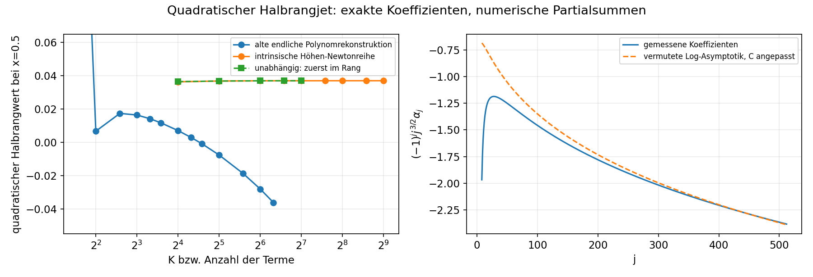
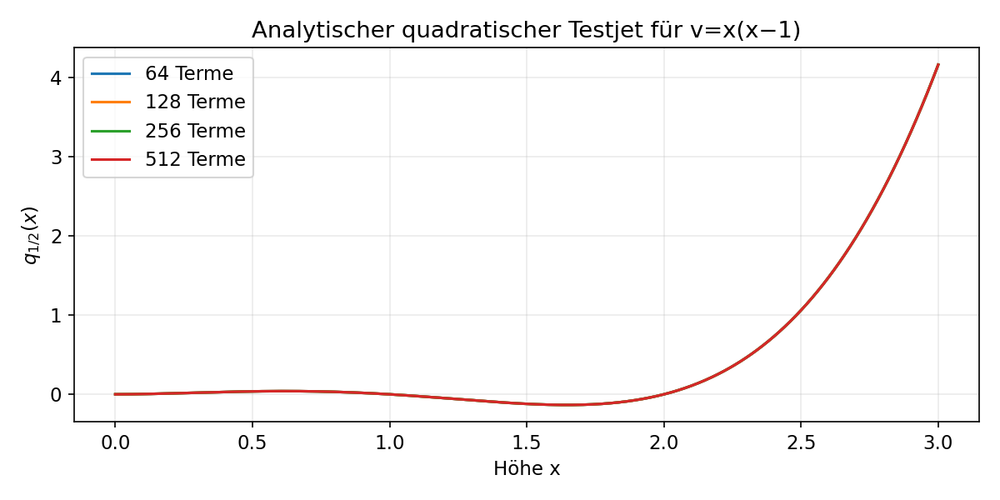

# Runde: analytische Fortsetzung des quadratischen Halbrangjets

Stand 2026-10-12. Eigener Strang zur Annäherung an H₃.₅, bei H₃(b,x)=bˣ und H₄=T_b. Der H₀-Beweis bleibt pausiert.

## Ergebnis

**Ein neuer analytischer Baustein ist bewiesen:** Für die Teststörung v(x)=x(x−1) besitzt die kanonische quadratische Rangfortsetzung bei Rangzuwachs ½ eine holomorphe Höhenfunktion auf **Re x>−1**. Die Funktion wird durch eine absolut und lokal gleichmäßig konvergente Newtonreihe konstruiert. Ein expliziter, allerdings sehr grober Rest ist verfügbar.

Damit wird aus den bisher isolierten ganzzahligen Werten ein analytischer Testjet

\[
x+1+\varepsilon\,2(B_{5/2}(x)-B_{3/2}(x))
+\varepsilon^2 q_{1/2}(x).
\]

Dies ist noch keine vollständige H₃.₅ zur Basis b: v ist eine polynomiale Teststörung; die bilineare Halbrangkorrektur für bˣ und die Konvergenz aller Ordnungen fehlen. Es wird hier keine neue kritische Basis η₃.₅ ausgegeben.

## Was bewiesen ist

- Eine Skala holomorpher Funktionen auf rechten Halbebenen mit polynomialem vertikalem Wachstum erlaubt normierte Abel–Plana-Summation mit expliziter Normschranke. Ableitung und Produkt besitzen kontrollierte Verluste innerhalb der Skala.
- Die ganzzahlige Höhenabtastung ist in dieser Skala eindeutig. Die lineare Ranggruppe Lₛ besitzt eine Integralform und verschiebt Bν zu Bν₊ₛ.
- Für den quadratischen Testjet sind die ganzzahligen Höhenwerte intrinsisch und exakt zugänglich; eine wachsende endliche Polynomableitung wird nicht benötigt.
- Die erzeugenden Funktionen enthalten Legendre-Funktionen und Jacobi-Parameterableitungen. Daraus folgt eine neue schnelle exakte Berechnung der Höhen-Newtonkoeffizienten.
- Für diese Koeffizienten genügt |αⱼ|≤1500(1+log j)/j, j≥3, um die Holomorphie auf Re x>−1 zu beweisen. Die grobe Konstante ist kein numerischer Fit.
- Eine zweite analytische Klasse über polynomial beschränkte Newtonkoeffizienten erlaubt eine exakte Ableitungsformel ohne endliche Polynomrekonstruktion. Die allgemeine Produktstabilität dieser Klasse ist falsch; ein Gegenbeispiel ist angegeben.

Alle Definitionen, Herleitungen und Konstanten stehen in [MATHEMATIK.md](MATHEMATIK.md), insbesondere §6 für den neuen Konvergenzbeweis. Standardformeln wurden in den unter [LITERATUR.md](LITERATUR.md) bezeichneten Primärquellen gelesen; die konkrete Rangrechnung ist eine eigene Herleitung.

## Der frühere Drift bei x=0.5

Die alte endliche Polynomrekonstruktion und die intrinsische Newtonfortsetzung zeigen verschiedene Verläufe:

| Größe | 16 | 32 | 64 | 128 | 256 | 512 |
|---|---:|---:|---:|---:|---:|---:|
| neue Höhen-Newtonpartialsumme bei x=0.5 | 0.036295410 | 0.036769756 | 0.036893004 | 0.036928657 | 0.036939510 | 0.036942876 |
| alte endliche Polynomrekonstruktion bei x=0.5 | 0.007002657 | −0.007670585 | −0.028087149 | — | — | — |

Ein unabhängiger Weg berechnet die **echten polynomialen Jets an ganzzahligen Rängen** und setzt anschließend zuerst im Rang fort. Seine Partialsummen bei x=0.5 sind 0.036757062 / 0.036882563 bei 32/64 Termen und nähern sich ebenfalls der neuen Funktion. Dieser Vergleich ist ein Hinweis auf das Problem der alten Rekonstruktion. Es ist kein allgemeiner Satz über die Vertauschbarkeit der beiden Grenzprozesse und kein Beweis, dass jede Folge endlicher Carlemanmodelle denselben Grenzwert besitzt.

Die Zahl 0.036942875969538… ist die **512-Term-Partialsumme**, nicht ein eng zertifizierter Grenzwert. Die bewiesene Restschranke ist dafür noch viel zu grob. Die Konvergenz selbst ist bewiesen.

Weitere Partialsummen:

| Höhe | 128 Terme | 256 Terme | 512 Terme |
|---|---:|---:|---:|
| 1.5 | −0.120497777810 | −0.120497876287 | −0.120497891502 |
| 2.5 | 1.060542852623 | 1.060542854174 | 1.060542854293 |
| 0.5+0.25i | 0.0495381843+0.0166004666i | 0.0495423022+0.0165871422i | 0.0495428457+0.0165828514i |

## Die vorhersehbare Struktur

**Bewiesen:** Der harmonische Anteil hat die geschlossene erzeugende Funktion

\[
2w^2(1+w)^s[P_{s+2}(1+2w)-1].
\]

Die volle quadratische Korrektur enthält zusätzlich die Jacobi-Parameterableitung und eine normierte Summe über Legendre-Funktionen. Beides ist in einer exakten Potenzreihenform beschrieben.

**Skizze mit benannter Lücke:** Bei w=−1 wird eine Struktur √(1+w) mal ein quadratisches Polynom in log(1+w) erwartet. Daraus sollten αⱼ≈(−1)ʲj⁻³/²(A log²j+B log j+C) folgen. A=−1/(2π√π) und der Kandidat B≈0.3375159091 wurden aus der Struktur hergeleitet; nur C wurde für die Grafik numerisch angepasst. Die komplexe Randentwicklung der Rangsumme und der Transferrest sind noch nicht vollständig bewiesen. Diese schärfere Vermutung wird **nicht** für den Holomorphiesatz verwendet.

## Warum die globale Funktionenklasse noch nicht reicht

Die Halbebenenklasse endlichen horizontalen Exponentialtyps enthält bˣ, die linearen Gamma-Rangjets und den vollen quadratischen Rangschritt. Die neue Halbrangfunktion ist in der Newtonklasse bewiesen; ihre Zugehörigkeit zur Halbebenennormklasse ist noch nicht gezeigt. Bei b>exp(1/e) enthält die Halbebenenklasse außerdem **keine vollständige Tetration**: deren ganzzahlige Werte wachsen schneller als jedes C exp(ak)kᵖ. Das ist im Bericht mathematisch bewiesen, kein bloßes numerisches Problem.

Gerade der unveränderte Eta-Fitwert bei Rang 3.5, 1.5568172767405143, liegt oberhalb exp(1/e). Ein voller Rangfluss von H₃ zu H₄ kann dort deshalb nicht in dieser globalen Klasse bleiben. Eine künftige Konstruktion braucht variable Wachstumsgewichte oder lokale holomorphe Bereiche entlang endlicher Höhen sowie eine Auswahlregel für den Rangfluss.

Für die echte Exponentialfamilie ist die lineare Halbrangkorrektur bereits explizit, siehe (A18). Die nächste konkrete Rechnung sollte Q₁/₂ auf Gamma-Modenpaare verallgemeinern, deren Reihen für bˣ kontrollieren und danach höhere Jets auf endlichen Höhenbereichen bearbeiten. Ein Eta-Fit allein bestimmt diese Funktionen nicht.

## Reproduzierbarkeit und Genauigkeit

- Zwei exakte Algorithmen stimmen in sämtlichen 129 überlappenden rationalen und log-2-Koeffizienten überein.
- Die vollständigen Uₖ,Vₖ-Polynome für k≤32 stimmen zwischen den Rechnungen mit Abschneidung 32 und 128 exakt überein.
- Die separat berechneten 129 ganzzahligen Rangjets bei Höhe 3 stimmen exakt mit der harmonischen geschlossenen Formel überein.
- Alle 127 nichttrivialen Legendre-Koeffizienten des harmonischen Anteils wurden rational geprüft.
- Die 512-Term-Werte an fünf reellen/komplexen Höhen stimmen bei 500 und 600 Dezimalstellen in allen 70 ausgegebenen Stellen überein. Das prüft Rundungsfehler der Partialsumme, nicht ihren Abschneiderest.
- 14 Abel–Plana/Gamma-Identitäten wurden mit 50 und 75 Dezimalstellen geprüft; die zusätzliche erzeugende Integralform mit 40 und 65 Stellen an w=0.1,0.3. Für deren abgeschnittenes Rangintegral ist eine explizite Restmajorante protokolliert.
- Längster Einzellauf: **265.634 Sekunden**, unter 4.5 Minuten. Keine 20-Minuten-Grenze wurde erreicht. Die schnellere Koeffizientenformel lieferte 512 Koeffizienten in 119.408 Sekunden.

Keine Intervallarithmetik, kein enger numerischer Grenzwertnachweis und kein abgeschlossener Beweis einer nichtlinearen Ranggruppe werden behauptet. `data/verification.json` protokolliert die erfolgreichen Konsistenzprüfungen.
