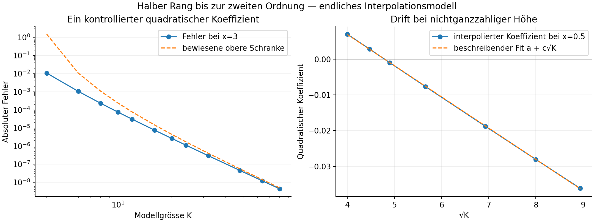
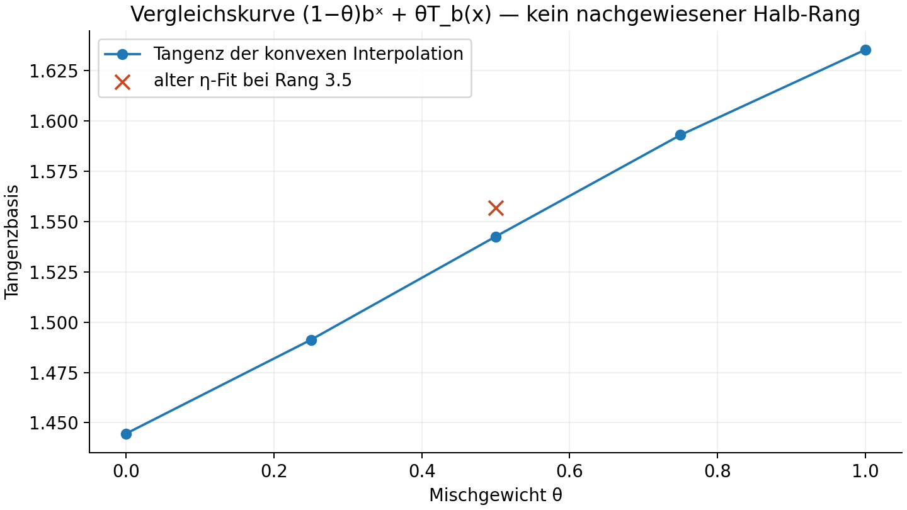

# Halber Hyperoperationsrang: erste nichtlineare Etappe

12.10.2026 · Eigener Forschungszweig · H₀-Arbeit bleibt pausiert

Der neue Brainstormingplan führt zu einem konkreten Ergebnis: **Ein halber Rangschritt ist im genau angegebenen endlichen Modell bis zur zweiten Ordnung konstruierbar und beweisbar.** Für einen ausgewählten Koeffizienten konnte ich sogar den Grenzübergang zur unendlichen Modellgrösse beweisen. Die Fortsetzung zu einer vollständigen analytischen Funktion bleibt dagegen offen; ein Test an nichtganzzahliger Höhe zeigt eine deutliche Drift und legt eine echte Funktionsraumlücke frei.

Ein belastbares H₃.₅(b,x), insbesondere H₃.₅,e, und dessen kritische Basis η₃.₅ wurden in dieser Runde **nicht** konstruiert. Eine passende Zwischenkurve allein würde dieses Ziel nicht erfüllen.

## Was jetzt bewiesen ist

Für f_ε(x)=x+1+εv(x) liefert der volle Rangschritt S_ε=x+1+εw+ε²z+… genau

\[
\Delta w=v(x+1),\qquad\Delta z=w(x)v'(x+1).
\]

Ich habe den vorgeschlagenen Testmodus v=x(x−1) und zwei weitere Modenprofile untersucht. Das endliche Modell speichert die Höhenwerte 1,…,K und benutzt das eindeutige Grad-K-Polynom auf 0,…,K zur analytischen Rekonstruktion. Sein vollständiger integerer Rangschritt ist exakt definiert; seine quadratische Carleman-Matrix hat nur den Eigenwert 1. Eine endliche Binomialpotenz liefert daraus T_s^K und insbesondere

\[
T_{1/2}^K\circ T_{1/2}^K=T_1^K+O(\|d\|^3).
\]

Das ist eine algebraische Identität, nicht nur eine gefittete numerische Beziehung. Sie gilt für beliebige Eingaberichtungen des Modells. Der daraus gewonnene quadratische Vektorfeldgenerator besitzt zusätzlich einen echten lokalen analytischen Modellfluss; dessen Zeit-eins-Abbildung trifft den vollständigen Modellschritt bis Grad zwei.

Für v=x(x−1) und Höhe x=3 ist der quadratische Koeffizient im Grenzmodell explizit:

\[
\boxed{Q_{1/2}(v,v)(3)=341/12-35\log2
=4.156515347068580837\ldots .}
\]

Die endlichen Modellkoeffizienten sind genau partielle Newtonreihen. Ihr Fehler ist positiv und für K≥4 höchstens

\[
\frac8{3\sqrt\pi}(K-3)^{-9/2};
\]

asymptotisch beträgt er (8/(3√π))K⁻⁹/². Der zugehörige quadratische Generatorbeitrag ist 2π²−13. Die ausführlichen Herleitungen stehen in [MATHEMATIK.md](MATHEMATIK.md), §§2–9.

## Der entscheidende Gegencheck

Die Kontrolle nur auf integeren Höhen reicht nicht. Nach Rekonstruktion der Modellwerte als Höhenfunktion ergibt sich bei x=0.5:

| K | quadratischer Halbschritt bei x=0.5 |
|---:|---:|
| 16 | +0.00700266 |
| 32 | −0.00767058 |
| 48 | −0.01879862 |
| 64 | −0.02808715 |
| 80 | −0.03621885 |

Ein beschreibender Fit auf diesem Bereich verhält sich wie a−0.008745√K. **Divergenz ist dadurch nicht bewiesen**, aber Stabilität als Funktion ist nicht belegt. Die Werte bei K=64 bleiben beim Wechsel von 150 auf 250 Dezimalstellen, also mit rund 332 zusätzlichen Bit, auf alle 65 gespeicherten signifikanten Stellen gleich. Die Drift ist kein sichtbares Rundungsartefakt.

Die Mathematik erklärt eine Schwäche dieser Modellwahl: In exponentiell gewichteten Sequenznormen ist der lineare Halbschritt uniform beschränkt, die globale Polynomableitung dagegen nicht. Für die Gewichtung 2 beträgt schon eine explizite untere Schranke des bilinearen Halbschrittoperators

\[
\|Q_{1/2}^K\|_2\ge
\frac{3\,2^{K-1}}{(2+\sqrt2)K(K-1)(K-2)(K-3)}.
\]

Sie wächst unbeschränkt. Damit scheidet ein beschränkter Grenzoperator dieser Modelle auf allen solchen Sequenzen aus. Eine kleinere analytische Klasse bleibt möglich; die ausschlaggebende Voraussetzung ist jetzt präzise benannt.

Auch eine endliche Gamma-Basis allein löst das Problem nicht: Für nichtganzzahlige Moden erzeugt die quadratische Gleichung dreifache Pole, während endliche Summen der ursprünglichen Gamma-Moden nur einfache Pole besitzen. Die Basis muss erweitert oder eine kontrollierte Summierung gefunden werden.

## Vergleich mit der Fitvorhersage für Rang 3.5

Der bestehende Fit wurde unverändert übernommen:

\[
\eta_{\rm fit}(r)=2-2.7849974381025855\,r^{-1.467173061332697},
\qquad\eta_{\rm fit}(3.5)=1.5568172767405143\ldots .
\]

Als ausdrücklich deklarierter Vergleich wurde die Mischkurve F_θ=(1−θ)bˣ+θT_b berechnet. Ihr Mittelwert θ=0.5 hat eine numerische lokale positive Tangenz bei

\[
b=1.54254852987747295\ldots,\qquad x=3.03219227221562488\ldots .
\]

Das liegt etwa 0.01427 beziehungsweise 0.9165 % unter der Fitbasis. Die Rechnungen mit 25/45 gewünschten Dezimalstellen und gleichzeitig geänderter Cauchykontur/-punktzahl stimmen in der Basis bis etwa 28 Dezimalstellen überein. Es gibt keine Intervallzertifizierung oder globale Schwellenwertbehauptung.

Diese Zwischenkurve ist kein H₃.₅. Der direkte Test ihrer natürlichen Fortsetzung über die Ränge bestätigt das: Die gemischten nächsten Stufen verletzen die Rangrekursion bei b=2, x=0.5 um −0.0004591 und bei b=e um −0.0234656. Die integeren Endpunkte bestehen denselben Test bis unter 2·10⁻³⁷. Eine frei gewählte Zwischenkurve kann eine plausible Tangenzbasis besitzen und trotzdem die geforderte Rangstruktur verfehlen.

## Was für das eigentliche Ziel als Nächstes erforderlich ist

Der nächste Schritt sollte eine analytische Klasse mit festgelegter Auswahl der Superfunktion sein. Auf dieser Klasse müssen sowohl die Gamma-Fortsetzung als auch die nichtlinearen Ableitungs-/Kompositionsterme kontrolliert werden. Erst damit lässt sich die quadratische Kohomologiegleichung für Q₁/₂ als **Funktion** lösen; ein bedingtes Banachraumlemma dafür steht in MATHEMATIK.md §12.

Danach braucht es Konvergenz aller Ordnungen und eine kontrollierte Fortsetzung bis zur Exponentialfunktion. Das ist für die kritische Basis wesentlich: Am kritischen Fixpunkt ist die Successor-Abweichung exakt −1. Eine lokal kleine Störung erreicht diesen Bereich ohne zusätzliche Restkontrolle nicht. Bei b=e ist eˣ zudem schon auf den ersten Höhen deutlich vom Successor entfernt.

Der skalar bewiesene Grenzwert bei x=3 kann eine gute Kontrolle für eine neue Funktionsraumkonstruktion sein. Der Test bei x=0.5 muss dabei ausdrücklich mitgeführt werden. Ein neuer Fit oder mehr integere Modellwerte würden diese Lücke nicht schliessen.

## Reproduzierbarkeit und Grenzen

- Modellgrössen K=3,4,6,8,10,12,16,20,24,32,48,64,80; Präzision bis 250 Dezimalstellen.
- Drei Eingabeprofile wurden bis K=64 geprüft; K=80 nur der polynomiale Testmodus. Die Halbkompositionsidentität und die exakte skalare Newtonformel stimmen innerhalb der gespeicherten Rundung überein; maximaler skalarer Unterschied 4.95·10⁻⁶⁵.
- Direkte endliche Modelliteration gegen zwei quadratische Halbschritte bei K=4,6,8 zeigt bei Halbierung von ε Fehlerquotienten nahe 8, wie für einen kubischen Rest erwartet. Die kubischen Vorfaktoren wachsen mit K; keine uniforme Restschranke wird behauptet.
- Der längste gespeicherte gesamte Modell-Durchgang benötigte rund vier Minuten. Alle GP-Arbeiter wurden beendet. Keine gemeinsamen Caches oder Quellprojekte wurden verändert.
- Der Brainstormingtext, die ursprünglichen η-Werte und der frühere Fitbericht sind unter `inputs/` eingefroren. `runtime/` enthält die verwendete GP-Version und deren Python-Wrapper. Hashes stehen in `MANIFEST_SHA256.json`.
- Literaturstatus und tatsächlich gelesene Abschnitte: [LITERATUR.md](LITERATUR.md). Ribóns formales Einbettungsprinzip wird nur auf das endliche Modell angewendet; keine analytische Einbettung des Rangoperators wird daraus abgeleitet.

Alle Skripte und Rohdaten sind enthalten; Einstieg [README.md](README.md). Der Zwischenstand der ersten Etappe wurde separat abgelegt. Der alte Beweiszweig blieb unberührt.
