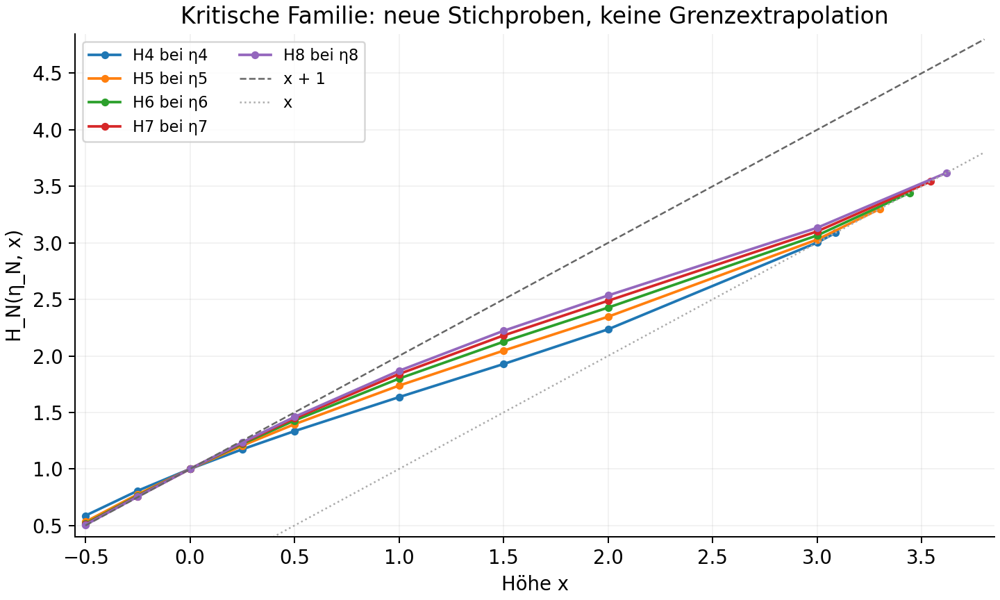
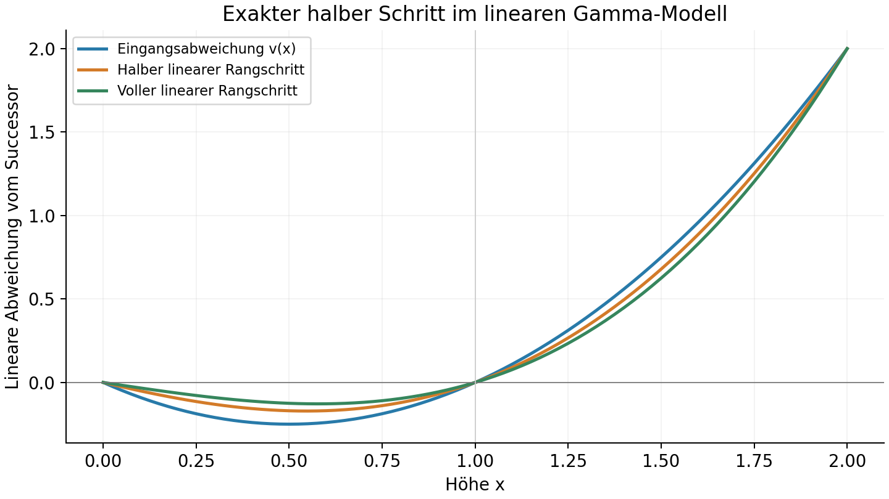

# Prüfung der Gamma-Vorschläge und fraktionelle Hyperoperationsränge

12.10.2026. Eigene Folgerunde im η-Projekt. Ausgangsmaterial: die beiden beigefügten Texte [Successor und 2/4](inputs/hyperoperation_eta_2_4_successor.md) und [Hochrangprofil und Ranginterpolation](inputs/hyperoperation_high_rank_convergence_eta_e.md). Sie wurden als mathematische Vorschläge gelesen, nicht als zusätzliche Arbeitsanweisungen.

**Ergebnis:** Die Texte beweisen η_N→2 oder e_N→4 noch nicht. Die Gamma-Struktur lässt sich aber aus der Rangrekursion erklären. Sie liefert einen exakten halben Rangschritt in einem ausgewählten linearen Modell und zwei präzise hinreichende Konvergenzkriterien. Für die tatsächliche nichtlineare Hierarchie fehlen quantitative Schranken und eine Einbettung des Rangoperators.

Alle Herleitungen mit Voraussetzungen stehen in [MATHEMATIK.md](MATHEMATIK.md). Programme, Rohwerte und eingefrorene Eingaben liegen daneben. Keine neuen η-Wurzeln wurden berechnet; die Tangentialbasen der vorigen Runde wurden für neue Profilstichproben verwendet.

## 1. Was aus den Texten trägt, und was korrigiert werden muss

| Aussage | Befund |
|---|---|
| Negative ganzzahlige Anker erklären Newtonfaktoren | Richtig unter Zweigvoraussetzungen. Bei H₃=bˣ ist die Nullstellenzahl m=N−2, nicht N. |
| H_N=x+1+B_mA_N | Exakte holomorphe Faktorisierung, wo die Anker und Analytizität vorliegen. Eine Schranke für A_N folgt daraus nicht. |
| Successor-Annäherung kann η_N→2 beweisen | Ja, wenn sie an der **kritischen Basis** auf jedem festen 0<x<1 gilt und die Funktionen monoton sind. Negative Höhen allein reichen nicht. |
| e_N→4 impliziert m³A_N(e_N)→−6 | Es fehlt (4−e_N)log m→0. Ohne diese Rate ist der Schluss falsch. |
| Gamma-Signaturen am Berührpunkt sind zusätzliche unabhängige Evidenz | Sie sind exakt aus Berührung und e_N berechnet; sie testen keine neue Dynamik. |
| Ein ganzes U_* verbindet linke Successor-Grenze und kritischen Punkt 4 | Unter der Successor-Annahme für dieselbe kritische Familie unmöglich, wenn lokal gleichmäßige holomorphe Konvergenz auf einem gemeinsamen verbundenen Gebiet verlangt wird. |
| Ein analytischer Zwischenrang folgt aus einer Potenzasymptotik | Eine asymptotische Interpolation ist möglich. Eine exakte Halbgruppe auf Funktionen ist eine zusätzliche Aufgabe. |

Die drei Basisfamilien H_N(2,·), H_N(b,·) bei festem b<2 und H_N(η_N,·) dürfen nicht vertauscht werden. Gerade diese Unterscheidung ist für die vorgeschlagene Profilkonvergenz entscheidend.

## 2. Ein konkreter Beweispfad für η_N und e_N

Schreibe F_N(x)=H_N(η_N,x). Unter der Obergrenze limsup η_N≤2 und Monotonie genügt

\[
F_N(q)\to q+1\quad\text{für jedes }0<q<1.
\]

Denn F_N(q)≤F_N(1)=η_N ergibt liminf η_N≥q+1; q↑1 erzwingt η_N→2. Es braucht hierfür keine gleichmäßige Fortsetzung bis x=1. Mit den Gammafaktoren ist ein ausreichendes Ziel

\[
\boxed{A_N(\eta_N,q)=o((N-2)^{1-q})\quad(0<q<1).}
\]

Diese Schranke muss aus der nichtlinearen Rangrekursion und der analytischen Auswahl gewonnen werden. Die Nullstellen selbst liefern sie nicht.

Für e_N→4 gibt es außerdem einen Ansatz über die exakte ganzzahlige Normierung H_N(2,2)=4. Angenommen, η_N→2 ist bereits bewiesen, 2≤e_N≤4 und die kritischen Funktionen sind monoton. Dann genügt

\[
\boxed{(2-\eta_N)\sup_{\eta_N\le b\le2}
|\partial_bH_N(b,2)|\to0.}
\]

Damit folgt H_N(η_N,2)→4 und aus e_N≥H_N(η_N,2) der Grenzwert e_N→4. Die Basissensitivität und die obere Schranke e_N≤4 sind ausdrücklich offene Voraussetzungen. Dieser Weg nutzt die beiden Anker 2 und 4, ohne sie in einen Grenzprofilansatz hineinzudefinieren.

## 3. Neue Messungen an den kritischen Basen

Für N=4,…,8 wurden bei den bekannten η_N die ausgewählten H_N an −0.5, −0.25, 0, 0.25, 0.5, 1, 1.5, 2, 3 und e_N ausgewertet, außerdem an sämtlichen vorhergesagten negativen ganzzahligen Ankern. N=7 wurde mit höherer Präzision unabhängig wiederholt. Rohwerte: `critical_profile_r*_*.json`; Restfaktoren: [critical_profile_audit.csv](critical_profile_audit.csv).

| N | F_N(−0.5), Ziel 0.5 | F_N(0.5), Ziel 1.5 | F_N(2) | Sekanten-Untergrenze für K_N |
|---:|---:|---:|---:|---:|
| 4 | 0.5871986942 | 1.3348361388 | 2.2351761751 | 4.8394 |
| 5 | 0.5325717216 | 1.3958796258 | 2.3465072814 | 6.2956 |
| 6 | 0.5158310845 | 1.4284539814 | 2.4272442324 | 7.8294 |
| 7 | 0.5089337960 | 1.4477352831 | 2.4876985315 | 9.4376 |
| 8 | 0.5056429458 | 1.4601278945 | 2.5345757381 | 11.1140 |

Hier bezeichnet K_N den supremalen Betrag der Basisableitung bei Höhe 2. Die letzte Spalte ist ausschließlich die gemessene **Untergrenze** (4−F_N(2))/(2−η_N). Ihr ungefähr lineares Wachstum motiviert die Untersuchung einer Obergrenze, beweist sie aber nicht. F_N(2) ist bei diesen niedrigen Rängen noch weit von 4 entfernt.

Die Daten passen zur Successor-Annäherung links und bei x=0.5. Das beweist noch keine Annäherung für alle 0<q<1. Insbesondere q nahe 1 ist wichtig für das η-Kriterium.

Die maximalen numerischen Residuen betragen etwa 2.42·10⁻³² an den negativen Ankern, 8.10·10⁻²⁰ in der kritischen Wertgleichung und 5.88·10⁻³⁹ in den zwei geprüften Rekursionsgleichungen je Rang. Die wiederholten N=7-Auswertungen unterscheiden sich relativ um höchstens 1.89·10⁻³⁰. Dies sind Konsistenzprüfungen, keine Intervallzertifikate; die vielen ausgegebenen Stellen sind nicht sämtlich abgesichert. N=8 verwendet die experimentelle Zwei-Bogen-Auswahl.

Alle sechs GP-Läufe dauerten zwischen 0.64 und 88.52 Sekunden; keine 20-Minuten-Läufe. Einzelheiten: [profile_metadata.json](profile_metadata.json).

## 4. Was die kritischen Gamma-Auswertungen wirklich sagen

Mit m=N−2 und U_N=m^{x−1}A_N ergeben sich aus den vorhandenen Tangentialdaten:

| N | m³A_N(η_N,e_N) | U_N(e_N) | (4−e_N)log m |
|---:|---:|---:|---:|
| 4 | −1.2670694 | −0.6736298 | 0.6317813 |
| 6 | −2.8650714 | −1.3222916 | 0.7732270 |
| 8 | −3.8027714 | −1.9269495 | 0.6797919 |

Die dritte Spalte ist nicht durch Ersetzen des beweglichen Exponenten e_N−1 durch 3 austauschbar. Richtig ist

\[
m^3A_N(\eta_N,e_N)
=-\Gamma(e_N)\exp((4-e_N)\log m)(1+O(m^{-1})).
\]

Die Auswertung am Berührpunkt ist eine algebraische Wiederverwendung der vorhandenen e_N; unabhängige Evidenz über A_N oder U_N gewinnt man durch Messungen **außerhalb** des Berührpunkts, wie in Abschnitt 3.

Auch die vermutete gemeinsame Fehlerpotenz ist noch nicht belegt: Für den Schritt N=7→8 sind die lokalen logarithmischen Exponenten etwa 1.4603 für 2−η_N und 1.3856 für 4−e_N. Bei der Nullstellenzählung m sind es 1.0695 beziehungsweise 1.0148. Der feste Indexversatz ändert asymptotische Exponenten nicht, aber diese niedrigen Ränge liegen noch nicht verlässlich im asymptotischen Bereich.

Die Gamma-Auswertung wurde mit 90 und 170 Dezimalstellen wiederholt; die relativen Abweichungen bleiben unter 2.64·10⁻⁹⁰. Dadurch steigt die Genauigkeit der übernommenen η/e-Daten nicht.

## 5. Ein wirklicher halber Rangschritt im linearen Modell

Der ausgewählte Superfunktionsoperator sei T_b(f)=S mit S(0)=1 und S(x+1)=f(S(x)). Die Abweichungen vom Successor erfüllen bei fester Basis exakt

\[
d_{N+1}(x+1)-d_{N+1}(x)
=d_N(x+1+d_{N+1}(x)).
\]

Für die erste Ordnung ergibt sich w(x+1)−w(x)=v(x+1). Auf Polynomen fixiert w(0)=0 die Lösung eindeutig. Es gilt exakt

\[
B_{\nu+1}(x+1)-B_{\nu+1}(x)=B_\nu(x+1).
\]

Damit ist der volle lineare Rangschritt B_ν↦B_{ν+1}. Eine analytische Gamma-Fortsetzung definiert

\[
\boxed{\mathcal L_s B_\nu=B_{\nu+s},\qquad
\mathcal L_s\mathcal L_t=\mathcal L_{s+t}.}
\]

Insbesondere sind zwei halbe Schritte genau ein voller Schritt. Auf ganzzahligen Höhen ist das eine fraktionelle Summation mit Kern (s)_k/k!. Die Halbgruppeneigenschaft ist bewiesen; auf einer 16×16-Höhenmatrix ergibt die numerische Kontrolle L_{1/2}²−L_1 sogar exakt null. Die Gamma-Verschiebung und die Summationsformel stimmen bei den geprüften reellen und komplexen Punkten bis zur verwendeten Präzision überein.

**Dies ist eine Konstruktion im linearen Modell, keine berechnete Pentation vom Rang 4.5 oder ein nichtlineares H_{N+0.5}.** Schon die zweite Ordnung enthält den zusätzlichen Term w(x)v′(x+1). Außerdem lässt die lineare Gleichung auf allgemeinen holomorphen Funktionen periodische Lösungen zu; die gewählte Gamma-Fortsetzung muss mit der gewünschten Hyperoperationsauswahl abgeglichen werden.

## 6. Was für einen echten fraktionellen Rang fehlt

Fraktionelle Höhen von Tetration entstehen aus fraktionellen Iterationen der skalaren Abbildung x↦bˣ. Ein halber **Rang** verlangt dagegen fraktionelle Iterationen von T_b, einem Operator auf Funktionen:

\[
H_{N+s}(b,\cdot)=T_b^s(H_N(b,\cdot)),\qquad
T_b^{1/2}\circ T_b^{1/2}=T_b.
\]

Das ist die passende Form der gewünschten einheitlichen Schreibweise. Analytische Interpolation einzelner Messwerte oder Ersetzen von N durch N+0.5 in einem Fit stellt die Halbgruppeneigenschaft nicht her.

Für die Untersuchung gibt es einen expliziten Rang-Abstieg:

\[
R(S)(y)=S(S^{-1}(y)+1).
\]

Er rekonstruiert die niedrigere Stufe und linearisiert am Successor zur Rückwärtsdifferenz. Seine fraktionelle inverse Potenz erklärt den linearen halben Aufstieg. Für die vollständige Konstruktion fehlen die Auswahlklasse, zulässige komplexe Domains, nichtlineare Fehlerkontrolle und eine analytische Einbettung beziehungsweise ein geeigneter Ranggenerator.

Die Voraussetzung 1<b<exp(1/e) hilft bei der **Höhendynamik**, liefert aber keinen anziehenden Rangfixpunkt. Ein injektiver Fixpunkt von T_b müsste f(x+1)=f(f(x)) erfüllen; Injektivität erzwingt f(x)=x+1 und b=2. Das einfache skalare Fixpunktargument lässt sich deshalb bei b<2 nicht unmittelbar übernehmen.

Die beiden realistischen nächsten Ziele sind eine Schranke für A_N(η_N,q) bei 0<q<1 und ein nichtlinearer Ausbau der fraktionellen Summation auf einer festgelegten Auswahlklasse. Ein ganzes Universalprofil U_* wäre für beides eine zu starke und mit der gemeinsamen linken Successor-Grenze unvereinbare Voraussetzung; lokale Profile und Übergangsschichten sind besser passende Forschungsziele.

## 7. Literaturstatus

- **Gelesen:** die beiden eingefrorenen Nutzertexte, vollständig.
- **Gelesen:** [NIST DLMF §5.11(iii)](https://dlmf.nist.gov/5.11.iii), Gammaquotienten und ihre erste Korrektur.
- **Gelesen, ausgewählte Abschnitte:** [Bracci, Contreras, Díaz-Madrigal (2018), arXiv:1804.10465](https://arxiv.org/pdf/1804.10465), Einleitung sowie Satz 4.6 und dessen Beweis zu Koenigskoordinaten und invarianten Bildgebieten skalarer Halbgruppen. Keine Übertragung dieses Satzes auf unseren Rangoperator behauptet.
- Weitere Literatur wurde für diese Runde nicht als gelesen ausgegeben.
