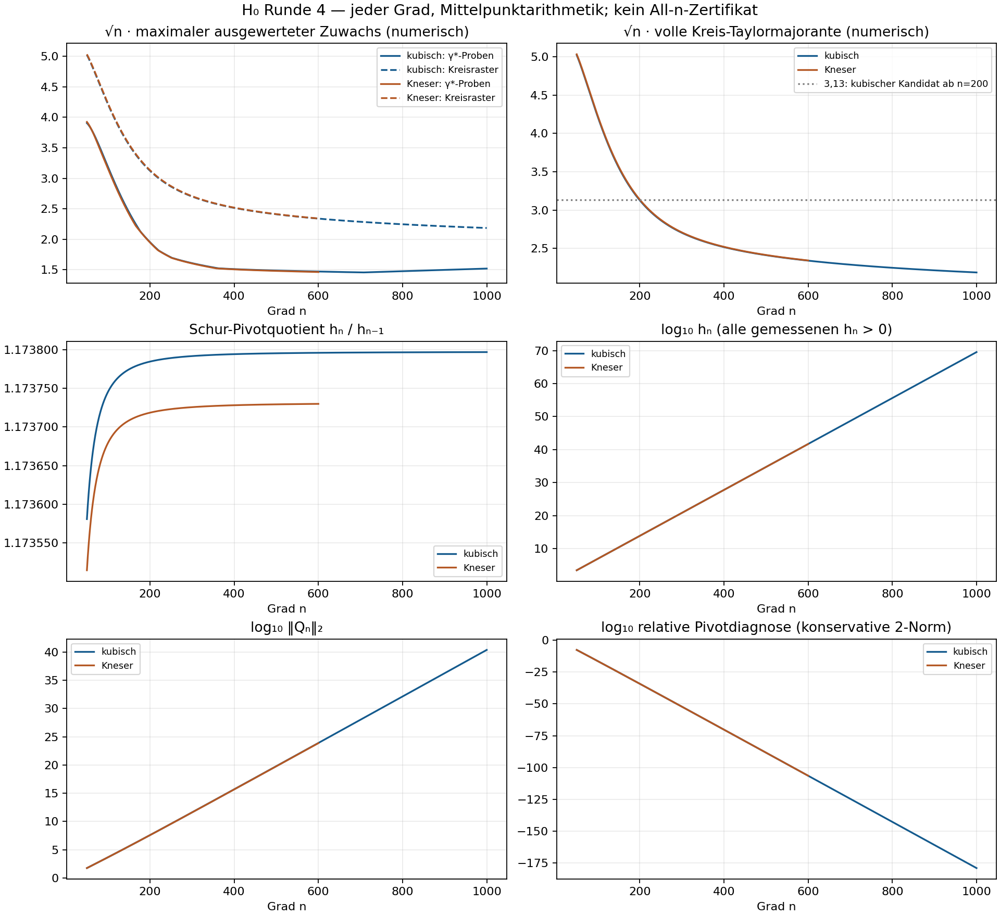

# Runde 4: lückenloser Graddurchlauf und funktionale Schur-Rekursion

**Strang G, 11.10.2026. Nur (H₀); K2 bleibt bei P.**

**Ergebnis A:** Jeder Grad **50…1000 kubisch (951 Grade)** und **50…600 Kneser (551 Grade)** wurde mit Schur-Bordering berechnet. Kein isolierter Ausreißer in den maximalen Zuwächsen, kein einzelner Schur-Pivot-Einbruch. Die Kreismajoranten fallen durchgehend. Das kubische Maximum an den festen γ*-Proben fällt zunächst und steigt nach einem flachen Minimum langsam wieder. **G19 wird in diesen endlichen Gradranges gestützt, nicht für alle n bewiesen.** Auch die schwächere konstante Zuwachsschranke hält numerisch in beiden Ranges.

**Ergebnis B:** Nach Abschluss von A wurde die gekoppelte Gradrekursion als **exakte Rekursion ausgewerteter Funktionen** ausgeschrieben. Auf den invertierten Eckscheiben sind die nötigen affinen Pullbacks Kontraktionen einer funktionalen Taylor-Wiener-Norm. Ein All-n-Beweis von G19 wurde damit versucht, aber der quellenhaltige globale Rekursionsrest konnte nicht abgeschätzt werden. Es gibt deshalb **keinen neuen All-n-Satz, kein neues n₁ und keinen Schluss auf den Gesamtbeweis**. C wird mangels Ausreißern nicht verfolgt.

Die frühere Runde ist unverändert in `RUNDE3_GRADZUWACHS.md` archiviert. Die sechs rigorosen Einzelgrad-Kreiszertifikate bleiben gültig und unverändert. Alle neuen dichten Scans sind **hochpräzise numerische Mittelpunktrechnungen**, keine Intervalleinschlüsse der inversen Matrix. Die neuen exakten algebraischen Herleitungen sind eigene Herleitungen; unabhängige P-Prüfung steht aus.

## 1. Aufgabe, Geometrie und Präzision

Es gelten die Normierung und Quelle aus Runde 3:

\[
e_{n,x}=((\rho/x)^k)_{k=0}^n,\qquad
v_n(x)=\widetilde J_n^{-1}e_{n,x},\qquad
\mathcal D_n(x)=\|Q_n\|_2\sum_{k=0}^n(\widetilde J_n^{-1})_{nk}(\rho/x)^k.
\]

Also ist |𝒟_n(x)| genau die Norm von v_n−ιv_{n−1}; dies bleibt die vollständige Cauchy-Quelle. Verwendet werden die bisherigen **20 festen γ*-Punkte plus L**, jetzt bei **jedem Grad**, sowie **72 Winkel** in 5°-Abständen auf

\[
|x-L|=r_n=\rho n^{-\beta},\qquad\beta=1/1.1182.
\]

Die reellen Modelle ergeben dieselben Kreisnormen an der konjugierten Ecke. Die festen Punkte stehen vollständig mit Koordinaten in den Scan-JSON-Dateien. Sie stammen weiterhin von der kubischen Vergleichskurve, auch beim Kneser-Vergleich. Ihre Prüfung ist kein Geometriezertifikat der ganzen Kneser-Kurve.

**Rechenpräzision:** Die Ausgangsmatrix wird einmal pro Sitzung bei 1300+max_n Bit aufgebaut. Die Rekursionsarithmetik wächst von **1200+n Bit**, somit 1250…2200 Bit in der berichteten kubischen Gradrange und bis 1800 Bit bei Kneser. Eine bewusst hohe Anfangspräzision schützt vor unwiderruflichem Rundungsfehler früher Schritte. Alle Matrixupdates werden auf Mittelpunkte zurückgesetzt. Ein Anheben der Präzision allein rekonstruiert keine verlorenen Bits; deshalb sind die unabhängigen direkten Lösungen wesentlich.

Das kubische numerische Modell verwendet dieselben Dezimalkonstanten für L wie `o_kern.py`, nicht ein neues Intervallmodell. Kneser verwendet die zertifizierten 640 Koeffizientenmittelpunkte (J_n benötigt a_{n+1}); die Eingaberadien werden **nicht** propagiert. Mehr Rechenbits verbessern hier die Rechnung für die gewählten Mittelpunkte und ersetzen keine Kontrolle des Eingabefehlers. Die Punkte und Kreisradien haben dieselbe Gleitkomma-Geometriekonvention wie Runde 3.

## 2. O(n²)-Bordering und Laufzeitgrenze

Ab hier bezeichnet J_n kurz den ρ-skalierten Abschnitt \(\widetilde J_n\).

Für \(\widetilde J_n=\begin{pmatrix}J_{n-1}&b_n\\\boldsymbol r_n^T&d_n\end{pmatrix}\) werden

\[
z_n=J_{n-1}^{-1}b_n,\quad w_n^T=\boldsymbol r_n^TJ_{n-1}^{-1},\quad h_n=d_n-\boldsymbol r_n^Tz_n,
\quad Q_n=(-z_n,1)^T
\]

berechnet. Das Inversenupdate lautet

\[
J_n^{-1}=\begin{pmatrix}
J_{n-1}^{-1}+z_nw_n^T/h_n&-z_n/h_n\\
-w_n^T/h_n&1/h_n
\end{pmatrix}.
\]

Zwei Matrix-Vektor-Produkte und ein äußerer Rang-eins-Update kosten **O(n²) skalare Operationen pro Grad**; die Bitkosten wachsen mit der Präzision. Die Matrix wird nicht für jeden Grad erneut gelöst. Native FLINT-Matrixfenster bearbeiten nur den aktiven n×n-Block. Der Pivotkehrwert wird einmal pro Grad gebildet und vor dem äußeren Produkt in einen Vektor eingerechnet. Das spart einen weiteren quadratischen Multiplikationsdurchlauf.

Die native Anbindung benutzt ausschließlich exportierte C-Funktionen und eigenes opakes Speicherlayout, keine internen Python-Objektadressen. API-Quelle: [FLINT arb_mat.h](https://raw.githubusercontent.com/flintlib/flint/v3.3.1/src/arb_mat.h). Die Schnittstelle wurde separat gegen rationale Inversen geprüft.

Jede Sitzung setzt nach etwa 900 Sekunden einen Zwischenstand: Diagnose-JSON plus komprimierte **gesamte aktive Inverse**. `--resume` liest genau diesen Zustand wieder ein; es startet keine neue Inversenlösung. Der kubische Graddurchlauf wurde bei der Zeitgrenze geteilt und setzt mathematisch dieselbe Rekursion fort. Die Ausgangsmatrix wird für die Fortsetzung erneut bereitgestellt. Das ist ein zusammenhängender Graddurchlauf in begrenzten Sitzungen.

- kubisch: Scan-Sitzungen 15.52, 5.59 Minuten; direkte Prüfsitzungen 10.51, 11.69 Minuten.
- kneser_z: Scan-Sitzungen 7.14 Minuten; direkte Prüfsitzungen 1.95 Minuten.

Zwei kurze Entwicklungsproben wurden früh beendet; ein Vergleichszwischenstand ist unter `archiv/h0_schur_benchmark_partial.json` erhalten. Seine veröffentlichten Punktwerte stimmen mit der endgültigen Umsetzung überein. Keine Sitzung des endgültigen Scans überschritt etwa 20 Minuten. Keine eigenen Rechenprozesse laufen nach Abschluss weiter.

## 3. Vollständiger Gradrange: Zuwächse und Trends

Die Tabellenwerte sind **numerisch**. „γ*“ bedeutet Maximum der 21 festen Proben; nur die Kreis-Taylormajorante ist eine numerische Majorante **aller Winkel** des entsprechenden Kreises.

| n | √n·max feste γ*-Proben kubisch | √n·max 72 Kreiswinkel kubisch | √n·volle Kreismajorante kubisch | √n·max feste Proben Kneser | √n·volle Kreismajorante Kneser |
|---:|---:|---:|---:|---:|---:|
| 50 | 3.905652 | 5.023141 | 5.023440 | 3.924419 | 5.034100 |
| 100 | 3.188334 | 4.215291 | 4.217589 | 3.158869 | 4.230872 |
| 150 | 2.443720 | 3.548836 | 3.552575 | 2.414883 | 3.564384 |
| 200 | 1.952311 | 3.122847 | 3.126349 | 1.947102 | 3.135619 |
| 300 | 1.608543 | 2.701080 | 2.702708 | 1.603481 | 2.708232 |
| 400 | 1.511118 | 2.515280 | 2.516129 | 1.506771 | 2.519955 |
| 600 | 1.471419 | 2.339235 | 2.339471 | 1.463445 | 2.342039 |
| 706 | 1.456348 | 2.284290 | 2.284404 | — | — |
| 800 | 1.476676 | 2.246198 | 2.246259 | — | — |
| 1000 | 1.519989 | 2.185399 | 2.185447 | — | — |

- kubisch: skalierter γ*-Probenwert minimal 1.456348383 bei n=706, Endwert 1.519988705. Größter relativer Aufwärtsschritt pro Grad 1.477e-04. Die skalierte Kreismajorante ist über **jeden** geprüften Grad streng fallend.
- Kneser: skalierter γ*-Probenwert minimal 1.463444617 bei n=600, Endwert 1.463444617. Keine Aufwärtsschritte im geprüften Bereich. Die skalierte Kreismajorante ist über **jeden** geprüften Grad streng fallend.

Das kubische Minimum des skalierten Proben-Maximums liegt bei n=706; dort übernimmt `lens_2` das Maximum von `lens_4`. Die anschließende sanfte Zunahme ist ein Wechsel der dominanten festen Probe. Sie ist keine Pivotresonanz und widerlegt eine endliche Schranke mit C_Δ=1,96 nicht. Insbesondere darf aus fallenden sechs Stichproben keine All-n-Monotonie des γ*-Maximums behauptet werden. Das unskalierte Proben-Maximum fällt dagegen bei beiden Modellen in jedem geprüften Gradschritt streng.

**Endliche numerische Kandidaten ab n=200:** C_Δ=1,96 an den festen Proben für beide Modelle; **3,13 auf den kubischen Eckkreisen**, **3,14 auf den Kneser-Eckkreisen**. Der letztere Wert ist ausdrücklich eigenständig gewählt; 3,13 darf nicht von kubisch auf Kneser übernommen werden. Keiner dieser neuen dichten Befunde ist ein All-n-Zertifikat.

Über die gesamten geprüften Ranges ab n=50 gilt numerisch √n·M_n<5,04 für beide Modelle. Auch die vom Auftrag erfragte schwächere konstante Form hält: **|𝒟_n|<0,56 an den festen Proben und <0,72 auf den ganzen Eckkreisen**. Dies sind endliche numerische Schranken.

- kubisch, gesamte geprüfte Gradrange: max |𝒟_n| an den festen Proben 0.552342625; volle numerische Kreismajorante maximal 0.710421711. Ab n=200: entsprechend 0.138049243 und 0.221066241.
- kneser_z, gesamte geprüfte Gradrange: max |𝒟_n| an den festen Proben 0.554996659; volle numerische Kreismajorante maximal 0.711929273. Ab n=200: entsprechend 0.137680923 und 0.221721715.

Die Rohdaten enthalten pro Grad alle 93 Punktwerte, h_n, h_n/h_{n−1}, ‖Q_n‖₂ und die volle Kreismajorante. `h0_schur_summary.json` enthält sämtliche lokalen Maxima des skalierten Proben-Maximums, die Schrittänderungen und die n-Intervalle der dominierenden Proben. Es wurden keine Grade ausgelassen oder auffällige Zwischenwerte entfernt.



## 4. Schur-Pivots: keine isolierte Resonanz, aber starke relative Auslöschung

Die gemessenen h_n sind positiv und streng wachsend. Die Pivotquotienten liegen kubisch durchgehend in [1,1735809524; 1,1737967238], bei Kneser in [1,1735148531; 1,1737298349]. Ihre Quotienten verlaufen glatt; die Q-Normen wachsen gleichzeitig stark. Einige Werte:

| Modell | n | h_n | h_n/h_{n−1} | ‖Q_n‖₂ | abs(h_n)/(abs(d_n)+‖𝐫_n‖₂‖z_n‖₂) |
|---|---:|---:|---:|---:|---:|
| kubisch | 50 | 2.70478629e+03 | 1.1735809524 | 5.68004778e+01 | 2.296e-08 |
| Kneser | 50 | 2.69730362e+03 | 1.1735148532 | 5.65934639e+01 | 2.293e-08 |
| kubisch | 200 | 7.38276876e+13 | 1.1737844717 | 3.94726962e+07 | 5.608e-35 |
| Kneser | 200 | 7.30049768e+13 | 1.1737184788 | 3.87117792e+07 | 5.628e-35 |
| kubisch | 600 | 5.06789292e+41 | 1.1737958260 | 8.12754658e+23 | 3.300e-107 |
| Kneser | 600 | 4.89997454e+41 | 1.1737298348 | 7.61068753e+23 | 3.371e-107 |
| kubisch | 1000 | 3.48285184e+69 | 1.1737967237 | 2.46599321e+40 | 9.933e-180 |

**Antwort auf die Pivotfrage:** In der festgelegten ρ-Skalierung wird kein einzelnes h_n annähernd null und kein Quotient bricht ein. Die kleinen **inversen** Diagonaleinträge p_n=1/h_n sind eine andere Größe. Sie sind kein Beleg eines kleinen Schur-Pivots. Die relative Diagnose in der letzten Spalte wird allerdings extrem klein: h_n ist die Differenz zweier wesentlich größerer Beiträge. Eine Invertibilitätsaussage für alle n oder eine robuste Störungsschranke darf daraus nicht abgeleitet werden. Das erklärt den Bedarf an hohen Bitzahlen und die Unbrauchbarkeit einer gewöhnlichen Gleitkommarekursion.

Die relative Diagnose ist eine konservative 2-Norm-Skala, keine Singulärzahl und kein Beweis einer Pivot-Untergrenze. Sie kann die tatsächliche skalare Auslöschung überschätzen. Bereits h_1000/abs(d_1000)≈2,17·10^−139 im kubischen Modell zeigt jedoch erhebliche Auslöschung. G10 benötigt Invertibilität der ganzen Folge und eine Schranke der **ausgewerteten** Funktionen; glatte endliche Pivots allein beweisen beides nicht.

## 5. Genauigkeitsprüfungen

- kubisch: Grade 50, 200, 400, 600, 800, 1000, jeweils 300 Bit über der Scanpräzision; maximale veröffentlichte Punktabweichung |neu−alt|/(1+|neu|) = 0, maximale Abweichung der vollen Kreismajorante auf derselben Skala = 0; kleinste lokale Auswertungsgenauigkeit 1512 Bit.
- kneser_z: Grade 50, 200, 400, 600, jeweils 300 Bit über der Scanpräzision; maximale veröffentlichte Punktabweichung |neu−alt|/(1+|neu|) = 0, maximale Abweichung der vollen Kreismajorante auf derselben Skala = 0; kleinste lokale Auswertungsgenauigkeit 1512 Bit.

Die direkten Gegenproben lösen die Systeme J_n c=e_n und J_n^T a=e_n für die letzte Spalte bzw. Zeile der Inversen mit `arb_mat.solve(algorithm="approx")`, ohne native Anbindung und ohne Schur-Historie. Damit prüfen sie mehr als eine Wiederholung desselben Rekursionsprogramms. Die lokale Auswertungsgenauigkeit betrifft nur Horner-/Polynomrechnung mit der berechneten Zeile, nicht den inversen Matrixfehler oder die Kneser-Eingaberadien.

Eine exakte rationale Modellprüfung bestätigt für n=0…8 die Paarekursion und die quellenhaltige ausgewertete Rang-eins-Identität. Die native Anbindung stimmt bei 384 Bit mit den rationalen Inversen bis auf <10^−100 überein. Die frühere N=200-Majorante 3,126348762… wird vom dichten numerischen Lauf reproduziert. Die entsprechenden alten Intervallzertifikate werden dadurch nicht ersetzt.

## 6. B: exakte funktionale Rekursion in n

Nach dem ausreißerfreien Test A betrachten wir die gekoppelte Rekursion. Alle Transpositionen sind bilinear. e_n bezeichnet den letzten Koordinateneinheitsvektor, ι die Auffüllung mit Nullen und q_j=‖Q_j‖₂. Setze

\[
\gamma_{nj}=\boldsymbol r_n^T\iota Q_j,\qquad
\eta_{nj}=(\iota A_j)^Tb_n,\qquad 0\le j<n.
\]

### G22 — gekoppelte Paare und ausgewertete Funktionen [eigene vollständige Herleitung; P-Prüfung offen]

Solange die Hauptabschnitte invertierbar sind, gelten exakt

\[
Q_n=e_n-\sum_{j<n}\frac{\eta_{nj}}{h_j}\iota Q_j,\quad
A_n=e_n-\sum_{j<n}\frac{\gamma_{nj}}{h_j}\iota A_j,\quad
h_n=d_n-\sum_{j<n}\frac{\gamma_{nj}\eta_{nj}}{h_j}.
\tag{G22a}
\]

Für w=ρ/x, \(\mathcal A_n(w)=\sum_k A_{nk}w^k\), folgt die **ausgewertete** Rekursion

\[
\boxed{\quad
\mathcal D_n(w)=\frac{q_n}{h_n}
\left[w^n-\sum_{j<n}\frac{\gamma_{nj}}{q_j}\mathcal D_j(w)\right].\quad}
\tag{G22b}
\]

Die Bezeichnung 𝒟_n(w) meint hier dieselbe Funktion nach dem Koordinatenwechsel w=ρ/x. Der volle inhomogene Quellterm w^n bleibt stehen.

**Beweis:** Setze die exakte biorthogonale Entwicklung aus W §25.1(c) \(J_{n-1}^{-1}=\sum_{j<n}(\iota Q_j)(\iota A_j)^T/h_j\) in z_n, w_n und h_n aus §2 ein. Dies ergibt die drei Formeln G22a. Aus der A_n-Formel folgt \(\mathcal A_n(w)=w^n-\sum_{j<n}\gamma_{nj}\mathcal A_j(w)/h_j\). Multipliziere mit q_n/h_n und verwende 𝒟_j=q_j𝒜_j/h_j. ∎

Das ist eine exakte Volterra-Rekursion mit der gesamten Vorgeschichte, keine automatisch geschlossene Drei- oder Viertermrekursion der letzten Paare. Sie kann mit dem quadratischen Matrix-Bordering ausgewertet werden. Die vier Zustände aus G8 transportieren Testkerne; sie bestimmen nicht ohne zusätzlichen globalen Schritt die inverse Amplitude in G22b.

Als algebraische Verbindung zum kubischen Kern gilt außerdem mit F(z)=f(ρz)/ρ und M(z)=m(ρz) für die Spaltenfunktionen p_j(z)=F(z)^j+M(z)z^j:

\[
p_{j+2}=(F+z)p_{j+1}-zF p_j.
\tag{G22c}
\]

Das folgt getrennt für beide geometrischen Folgen. Beim Kubikmodell hat F Grad 3, also ist der Zeilenversatz in dieser Identität endlich. Für Kneser bleibt die formale Identität wahr, aber F ist kein Polynom; eine endliche Bandstruktur wird nicht übertragen. G22c ist eine Kernidentität, kein Beweis von G19.

## 7. Funktionale Kreisnorm und der versuchte All-n-Schritt

Der x-Kreis bildet sich unter w=ρ/x auf \(|w-c_n|=R_n\) ab, mit

\[
c_n=\frac{\rho\overline L}{\rho^2-r_n^2},\qquad
R_n=\frac{\rho r_n}{\rho^2-r_n^2}.
\]

Setze \(F_n(\zeta)=\mathcal D_n(c_n+R_n\zeta)\) und
\(M_n=\|F_n\|_{\mathcal W}=\sum_k|[\zeta^k]F_n|\).
Das ist die berechnete volle Kreismajorante. Es handelt sich um eine **Funktionsnorm auf dem Eckkreis**, nicht um die ursprüngliche Koeffizientennorm von A_n oder Q_n. Sie berücksichtigt die Auslöschung vor der Normbildung durch die Verschiebung zum Kreiszentrum.

### G23 — verschachtelte Kreise und kontraktive Pullbacks [eigene vollständige Herleitung; P-Prüfung offen]

Für n≥j≥2 sind die x-Scheiben ineinander enthalten und meiden 0, denn r_j<ρ=|L|. Bei j=1 wäre r_1=ρ; dieser Randfall wird ausdrücklich ausgeschlossen. Ihre w-Bilder sind ebenfalls ineinander enthalten. Daher gilt für
\(a_{nj}=(c_n-c_j)/R_j\), \(b_{nj}=R_n/R_j\):

\[
|a_{nj}|+|b_{nj}|\le1,\qquad
\|P(a_{nj}+b_{nj}\zeta)\|_{\mathcal W}\le\|P\|_{\mathcal W}.
\tag{G23}
\]

Für n>j ist der geometrische Abstand zur Eins sogar explizit: \(1-|a_{nj}|-|b_{nj}|=(r_j-r_n)(\rho-r_j)(\rho-r_n)/[r_j(\rho^2-r_n^2)]>0\).

**Beweis:** Die Kreisscheiben-Inklusion liefert |c_n−c_j|+R_n≤R_j. Für jede Monombasis folgt die zweite Aussage aus \(\|(a+b\zeta)^k\|_{\mathcal W}\le(|a|+|b|)^k\); summiere mit den Beträgen der Taylor-Koeffizienten. ∎

G22b gilt damit für die Terme j≥2 in einer gemeinsamen Einheitskreis-Koordinate mit diesen affinen Pullbacks; j=0,1 bleiben explizite endliche Anfangsterme. Dies isoliert eine geometrische Schwierigkeit: Die Gebietswechsel kosten in dieser funktionalen Norm nichts. **Die globale, inhomogene Rekursionsbilanz ist jedoch nicht kontrolliert.** Der einzelne Quellterm und die transportierte Vorgeschichte dürfen vor der Auslöschung nicht getrennt majorisiert werden. Das wäre gerade die von W §22.4 ausgeschlossene Bucht-Induktion. Es wurde deshalb keine solche Koeffizienteninduktion als Beweis ausgegeben.

**Versuch des rechnergestützten/asymptotischen Anschlusses:** Ein tatsächlich hinreichender starker Anschluss wäre für explizit bestimmte unimodulare Phasen χ_n

\[
\|\chi_n^{-1}\sqrt n\,F_n-P_\infty\|_{\mathcal W}\le A n^{-\delta},\quad
\|P_\infty\|_{\mathcal W}\le M_\infty<C_\Delta,
\tag{G24}
\]

mit explizitem A, δ>0 und invertiblen Abschnitten auf dem gesamten Schwanz. Dann reicht
\(n\ge n_1=\lceil(A/(C_\Delta-M_\infty))^{1/\delta}\rceil\), mit n₁ gegebenenfalls auf den Beginn der asymptotischen Aussage erhöht. Für n<n₁ müsste der endliche Teil rigoros kontrolliert werden. Das wäre eine starke Abschätzung der **ganzen ausgewerteten Profile**; eine n-te-Wurzel-Rate genügt nicht.

**Stand des Versuchs:** Die Rekursion und G23 liefern bislang keine normierte Approximation mit einem bewiesenen Fehler A n^−δ. Auch die richtige globale Phase und Amplitude von P_∞ sind dadurch nicht bestimmt. Die dichten Werte M_n belegen numerische Schranken, aber keine Schranke des Rekursionsrests für n>1000. Deshalb werden weder M_∞ aus einem Fit noch A, δ oder n₁ erfunden. Der All-n-Schritt bleibt genau hier offen. Für die restliche feste γ* wäre zusätzlich eine entsprechende funktionale Kontrolle auf festen Konturteilen nötig; die Eckkreise allein ersetzen sie nicht.

**Explizite konditionale Konsequenzen bleiben:** Mit einer künftig bewiesenen kubischen Kreis-Zuwachsschranke C_Δ=3,13 ab n=200 und der alten zertifizierten Anfangsnorm C₀<12,5026 folgt C_G=6,26, κ_G=1/2 auf den Eckscheiben. Für Kneser ist weder dieselbe C₀ noch dieselbe All-n-Schranke bewiesen. Für die volle feste γ* bleiben ebenfalls Anfangsnorm, Kurvenkontrolle und All-n-G19 offen. Nur bei einer bewiesenen vollen γ*-Schranke lautet die Schnittstelle zu X weiterhin C_E=4,95 C_G+0,728√(1+1/N₀); ihre Geometriezahlen sind numerische Eingänge, und daraus wird kein neues Gesamt-N₀ behauptet.

## 8. Ablage und Reproduktion

Eigener Ordner weiterhin `forschung/polynom_halbexp/g_gpt_hilfssaetze/`. Keine anderen Forschungsdaten wurden verändert. BRETT-Eintrag wird unter der Kopfzeile eingefügt.

```powershell
python -B experimente/h0_schur_scan.py --project-root .. --output-dir ergebnisse --model kubisch --max-n 1000
# Falls completed=false: derselbe Aufruf mit --resume setzt den gespeicherten Zustand fort.
python -B experimente/h0_schur_scan.py --project-root .. --output-dir ergebnisse --model kubisch --max-n 1000 --resume
python -B experimente/h0_schur_scan.py --project-root .. --output-dir ergebnisse --model kneser_z --max-n 600
python -B experimente/h0_schur_direct_checks.py --project-root .. --output-dir ergebnisse --model kubisch --degrees 50,200,400,600,800
python -B experimente/h0_schur_direct_checks.py --project-root .. --output-dir ergebnisse --model kubisch --degrees 1000
python -B experimente/h0_schur_direct_checks.py --project-root .. --output-dir ergebnisse --model kneser_z --degrees 50,200,400,600
python -B experimente/h0_schur_exact_checks.py --output-dir ergebnisse
python -B experimente/h0_schur_analyze.py --dir ergebnisse
```

Python: `C:/Users/janis/miniconda3/python.exe`; native DLL aus dem installierten python-flint-Wheel. Die native Brücke ist auf dessen 64-Bit-Windows-ABI ausgelegt. Alle Programme vermeiden Bytecode-Dateien in fremden Forschungsordnern. `MANIFEST.json` enthält Datei- und Quellenprüfsummen; `PRUEFUNG_RUNDE4.md` dokumentiert die Prüfungen.

Die Cauchy-Korrektur bleibt bei nicht-polynomialem f weiterhin **I_F−B_y**. Keine Grad-5N-Konstruktion, keine zusätzliche nichtlineare Freiheit, keine K2-Experimente, keine neue SVD und keine Nachrichten an andere Chats.
