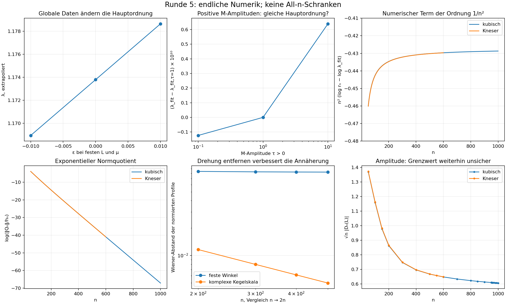

# Runde 5: starke Schur-Asymptotik — Ergebnisse und offene Mathematik

**11.10.2026 · Strang G · alle vier Etappen abgelegt · nur (H₀), K2 bleibt bei P.**

Die Runde liefert bewiesene Sätze für einfache und echte nichtlineare Hilfsmodelle, eine neue exakte Struktur des allgemeinen Operators und deutlich präzisere numerische Profilkandidaten. **Eine geschlossene Formel für λ des ursprünglichen kubischen/Kneser-Modells und ein Beweis von (H₀) wurden nicht erreicht.** Die noch fehlenden Uniformitätsannahmen stehen jeweils ausdrücklich neben den bedingten Aussagen.

Die vollständigen Zwischenstände mit Beweisen sind [Etappe 1](ETAPPE1.md), [Etappe 2](ETAPPE2.md), [Etappe 3](ETAPPE3.md) und [Etappe 4](ETAPPE4.md).

## 1. Was bewiesen wurde

- Für reine Komposition: det J_n=F′(0)^{n(n+1)/2}, h_n=F′(0)^n und explizite Q-, A- und 𝒟-Formeln über den inversen Jet. Für affine und bei 0 fixierende Modelle gibt es exakte starke Determinantenasymptotik mit Produktschwanz und Konstanten.
- Das affine Randfixpunktmodell F=2z−1, M=0 hat 𝒟_n(1)∼(πn)^{−1/4}. Der ursprünglich gewünschte n^{−1/2}-Vorfaktor folgt also nicht aus einer allgemeinen Pivotasymptotik.
- Für den gesamten Operator besitzt die gemischte erzeugende Funktion genau die beiden Kanäle 1−sF(z) und 1−sz. Eine dazugehörige endliche Verschiebungsidentität hat Rang höchstens zwei (G39/G40).
- Für die **echte quadratische Familie** F_η=2z+ηz², M_η=F_η′∘F_η, |η|≤1/20, sind h_n=2^n+2, Q_n=e_n und alle Hauptabschnitte invertierbar. Auf einem festen größeren Kreis wird die inverse Gleichung mit ihrer Quelle kontrolliert; insbesondere gilt uniform |𝒟_n(w)|≤20(2/3)^n auf |w|≤1. Dies ist eine bewiesene nichtlineare Störung eines gelösten Modells.
- Die alten Eckkreise liegen für **jedes n≥50** im natürlichen inneren Kreis mit festem Vergrößerungsfaktor 1,05. Die Geometriezahlen sind mit Rouché/Arb intervallzertifiziert. Daraus folgt die bedingte Eckschranke G37.
- Die Summation von kontrollierten Pivotquotienten (G32/G33), starke bilineare Matchingprofile (G31) und ein quellenbezogenes globales Parametrixkriterium (G43) liefern präzise bewiesene Implikationen. Ihre relevanten Hypothesen sind beim ursprünglichen Modell noch offen.

Der quadratische Satz kontrolliert einen globalen inversen Zweig, der strikt ins Innere kontrahiert. Diese Reserve fehlt an den ursprünglichen Randfixpunkten. Deshalb ist er ein Hilfssatz mit klarer Grenze und kein fertig übertragener Beweis von (H₀).

## 2. λ und nächste Ordnung: endliche numerische Befunde

Neun Modellfamilien wurden für jeden Grad 25…400 gerechnet. Drei Familien wurden unabhängig bis 600 fortgesetzt; ihre auf 250…400 trainierten Quotientenfits treffen 401…600 mit maximalen log-Fehlern zwischen 6,4·10^−13 und 9,1·10^−12. Zwei +300-Bit-Kontrollen bestätigen die gespeicherten Quotienten.

Eine reale Grad-4-Störung hält L und μ **exakt** fest und ändert λ um ungefähr 0,00970 zwischen η=−0,01 und +0,01. Ein realer Kubikgrad hat bei diesen vier reellen Bedingungen keine verbleibende Freiheit. λ enthält demnach numerisch globale Informationen. Vier konkret geprüfte einfache Kreis-Mittel-/W̄-Kapazitätsformeln passen nicht; damit wurden keine passend geklebten Kapazitäts- oder Gleichgewichtsformeln allgemein ausgeschlossen.

| Ursprüngliches Modell | λ, extrapoliert | c₂ in log(h_n/h_{n−1})=log λ+c₂/n²+… |
|---|---:|---:|
| kubisch | 1,1737972269226 | −0,42726205 |
| Kneser | 1,1737312357801 | −0,42726305 |

Die lückenlosen Runde-4-Daten und getrennte Kontrollfenster sprechen für eine 1/n²-Hauptkorrektur. Kein All-n-Fehlerbound und kein gesicherter Grenzwert wird daraus abgeleitet. Der Potenzexponent von ‖Q_n‖/h_n ist trotz klar sichtbaren Exponentialteils noch fitabhängig. Er wurde nicht festgelegt.

## 3. Das neue innere Profil

Komplexe Schurpaare und vollständige verschobene Profilpolynome wurden kubisch bis 1000, Kneser bis 600 gespeichert. Unabhängige direkte +300-Bit-Lösungen bei 400 bestätigen die komplexen Kurvenwerte mit relativer Abweichung unter 2,3·10^−45.

Die natürliche komplexe Skala ist

\[
a=\kappa^{-1}=0.89358616401917+0.02531610080330i,\qquad
d_n=n^{-a},\qquad
S_n(\zeta)=\frac{\mathcal D_n(w_L+d_n\zeta)}{\mathcal D_n(w_L)}.
\]

Sie enthält eine logarithmische räumliche Drehung. Nach deren Berücksichtigung fällt der Wiener-Abstand 400→800 von etwa 0,08259 auf 0,006107. Ein auf 200…600 trainierter fraktionaler Formfit trifft das natürliche normierte Profil bei 1000 in W_{1.05} mit Fehler etwa 6,1·10^−7. **Das ist endliche Vorhersagekontrolle, keine bewiesene Fehlerrate n^{−δ}.**

Die skalare Schurphase χ_n=𝒟_n(L)/|𝒟_n(L)| wurde explizit bestimmt und gefittet. Der Kandidat ν=2 Im(a) für ihren logarithmischen Phasenterm ist numerisch sehr gut vereinbar. Auf der ganzen γ* zeigen verschiedene Punkte verschiedene schnelle Phasenträger; eine gemeinsame skalare Phase wurde dort nicht als Grenzprofilbestätigung ausgegeben.

Die normierte innere Form ist stabiler als ihre Amplitude B_n=√n|𝒟_n(L)|. B_1000≈0,606643; ein zuverlässiger B_∞ mit Fehlergrenze fehlt. Auch der ganze unendliche Profilrest bleibt offen.

Die alte Skala β=1/1,1182 unterscheidet sich von Re(a) um ε≈0,00070824. Unter starken Profilannahmen schrumpft deshalb das alte Profil langfristig zur Konstante, mit möglicherweise dieser sehr kleinen Fehlerrate. Die beobachtete Drehung wurde **nicht** als Widerlegung einer alten skalaren Profilkonvergenz missverstanden.

## 4. Was für (H₀) fehlt

Für die Eckkreise würden die beiden uniformen Bounds

\[
B_n\le0.75,\qquad \|S_n\|_{\mathcal W,1.05}\le4
\quad\text{für alle }n\ge300
\]

zusammen mit G37 die Konstante C_Δ=3 liefern. Die gespeicherten Profile sind damit vereinbar; die All-n-Behauptung ist **nicht bewiesen**. Für die feste restliche γ* fehlt zusätzlich die äußere funktionale Kontrolle.

Die globale Beweisaufgabe wurde in Etappe 4 in fünf konkrete Lücken aufgeteilt: bewiesene Klebungsgeometrie, quellenverträgliche äußere Matchingprofile, innerer Profil-/Amplitudenrest, uniforme Restinversion und kontrollierte Störung zu Kneser. Bei nichtpolynomialem F muss **I_F−B_y** in der exakten Gleichung erhalten bleiben.

**Nächster erfolgversprechender Schritt:** Eine globale inhomogene Parametrix des exakten Zwei-Kanal-Cauchy-Operators im kubischen Modell bauen. Ihr innerer Bound soll das ganze unnormierte Profil √n𝒟_n(w_L+n^{−a}ζ) in W_{1.05} erfassen und die äußere γ*-Quelle gleichzeitig kontrollieren. Für eine H₀-Schranke sind geschlossene Formeln für B_∞ und S_∞ nicht zwingend nötig.

## 5. Ablage und Prüfung

Im eigenen Forschungsordner liegen alle vier Etappen, Rohdaten, Kontrollfits, zwei Abbildungen und die Programme mit portablen Pfaden. README.md enthält Reproduktionsbefehle; verification.json dokumentiert die abschließenden Kontrollen. Große Inversen-Checkpoints bleiben Zwischenmaterial.

Alle tatsächlich durchgeführten numerischen Einzelsitzungen blieben unter 20 Minuten; die längste neue zusammenhängende Sitzung war der Dreifamilienlauf bis 600 mit rund 834 Sekunden. Runde 4 ist unverändert archiviert. Jeder BRETT-Eintrag wurde unterhalb der Kopfzeile angefügt; die alten Einträge blieben erhalten.

Literatur wurde nach Lesestatus gekennzeichnet. Die neuen eigenen Beweise benötigen keine ungelesenen Szegő-/Riemann–Hilbert-Sätze. (H₀) bleibt offen; keine Grad-5N-Konstruktion und keine Übernahme von K2.
