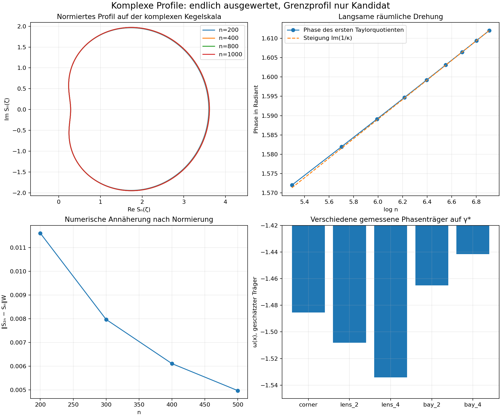

# Runde 5 — Etappe 3: komplexe Profile und logarithmische Drehung

**Zwischenstand nach Etappe 3. Nur (H₀); K2 bleibt bei P.**

## 1. Ergebnis und Genauigkeit

**Numerisch neu:** vollständige komplexe Schurpaare/𝒟-Profile kubisch bis n=1000 und Kneser bis 600, einschließlich benachbarter Grade 950…960. Gespeichert sind alle 21 festen γ*-Proben, 120 Eckkreiswinkel und die ganzen in die Kreiskoordinate verschobenen Taylorpolynome. Die Präzision beträgt 1200+n Bit. Eine unabhängige direkte +300-Bit-Lösung bei 400 in beiden Modellen bestätigt auch die **komplexen** Werte bis auf die 45-stellige Speicherung, relative Abweichung <2,3·10^−45.

Die kubischen Sitzungen brauchten 723,2 und 508,6 Sekunden, Kneser 368,4 Sekunden. Der zweite kubische Lauf liest den unveränderten Runde-4-Zustand bei 914 und setzt dieselbe Rekursion fort. Der große Inversen-Zwischenstand wird nicht veröffentlicht; die kleinen Ergebnisdateien und Programme werden vollständig abgelegt. Keine neue SVD.

Die Hauptbeobachtung ist eine **logarithmische räumliche Drehung** des normierten Eckprofils. In der komplexen Kegelkoordinate nähern sich die Profile deutlich besser an. Die skalare Amplitude ist wesentlich unsicherer als die Form. Ein fertiger All-n-Satz (G24) wird nicht behauptet.

## 2. Zwei verschiedene Phasen

Schreibe w=ρ/x, w_L=ρ/L. Wo der Eckwert nicht null ist, setzen wir

\[
\chi_n=\frac{\mathcal D_n(L)}{|\mathcal D_n(L)|}.
\]

Das ist eine **explizite datenabhängige Phase**. Ihre Definition beseitigt keine All-n-Aufgabe. Die skalare Schurphase hat numerisch einen schnellen Träger. Aus 950…960 und Rückprüfungen bei 200…1000 folgt der Fit

\[
\chi_n\approx\chi_{1000}\exp i\left[
\omega(n-1000)+\nu\log(n/1000)
+d_1(n^{-1}-1000^{-1})+d_2(n^{-2}-1000^{-2})\right].
\]

Alle Konstanten stehen in phase_analysis.json. ω≈−1,485420658. Breite Fenster 200…1000 bzw. 400…1000 mit drei inversen Korrekturen geben ν≈0,0506321983 bzw. 0,0506322008. Der lokale Kandidat ν=2 Im(1/κ)=log|μ|/π≈0,0506322016 passt dazu. **Diese Identität ist eine Konjektur**, keine bewiesene Monodromieformel der Schuramplitude. Hohe Fitordnungen im engen Fenster 950…960 sind instabil; auch diese Ausgaben bleiben erhalten.

Der Fit aus 950…960 mit zwei inversen Korrekturen hat bei 200 etwa 10^−6 Phasenabweichung; ohne die inversen Korrekturen etwa 5,4·10^−4. Das sind endliche Rückprüfungen mit Anker 1000, keine uniforme Fehlerabschätzung.

**Die räumliche Drehung ist eine andere Größe:** Sie betrifft das Argument des ganzen Profilpolynoms und enthält exp(−i Im(1/κ)log n). Eine skalare χ_n ersetzt diese Drehung bei einem nichttrivialen Profil nicht generell.

## 3. Komplexe Kegelskala

Die bei W/O auftretende Kegelzahl liefert

\[
\kappa=\frac{2\pi i}{2\pi i-\log\mu},\qquad
a=\kappa^{-1}=0.89358616401917+0.02531610080330i,\qquad d_n=n^{-a}.
\]

**Lemma G35 [bewiesen, algebraische Skalenidentität].** Mit dem logarithmischen Lift log d_n=−a log n gilt n exp(κ log d_n)=1. Außerdem |d_n|=n^{−Re a} und arg d_n=−Im a log n modulo 2π.

*Beweis:* κa=1. Real- und Imaginärteil der Exponentialfunktion ergeben die beiden anderen Aussagen. ∎

Dies beweist **nicht**, dass 𝒟 diese Parametrix besitzt. Es identifiziert die Koordinate für einen auf κ beruhenden Satzkandidaten. Der Bezug zu Ws Grenzproblem ist die Deckverschiebung 2πi−log μ. Die lokale Profilform muss an die globale quellenhaltige Lösung angepasst werden.

Das normierte Profil ist

\[
S_n(\zeta)=\frac{\mathcal D_n(w_L+d_n\zeta)}{\mathcal D_n(w_L)},\qquad S_n(0)=1.
\]

Hier bezeichnet 𝒟 in der w-Koordinate dieselbe Funktion wie zuvor in x. Die Rechnung verschiebt zuerst die hochpräzisen Kreis-Taylorpolynome. Die auf 70 Stellen gespeicherten ursprünglichen A-Koeffizienten werden **nicht** zur Auswertung in der Bucht verwendet. So bleibt die Auslöschung vor der Normbildung erhalten.

## 4. Form des Grenzprofils: numerischer Kandidat

| Vergleich | Wiener-Abstand bei festen Winkeln, durch Eckwert normiert | Wiener-Abstand auf komplexer Kegelskala |
|---|---:|---:|
| 200→400 | 0,08386400 | 0,01160464 |
| 300→600 | 0,08294741 | 0,00796855 |
| 400→800 | 0,08258635 | 0,00610658 |
| 500→1000 | 0,08239950 | 0,00496926 |

Der effektive Exponent aus 200→400 und 400→800 liegt etwa bei 0,93. **Das ist keine bewiesene Fehlerrate.** Ein Ansatz mit Korrekturen n^{−Re a}, n^{−1}, n^{−2Re a}, trainiert nur bei 200,300,400,500,600, sagt das Profil bei 700,800,900,1000 in der gewichteten Wiener-Norm mit Radius 1,05 voraus: Fehler ungefähr 8,6·10^−8, 2,2·10^−7, 4,0·10^−7 und 6,1·10^−7. Ein reiner 1/n,1/n²-Ansatz hat bei 1000 etwa 1,0·10^−4 Fehler. Die Kegelskala beschreibt also auch einen strukturellen **Kandidaten für die Korrekturordnungen**.

Der daraus extrapolierte kubische Profilkandidat beginnt ungefähr mit

\[
S_\infty(\zeta)\approx1+(0.16895+1.25576i)\zeta
+(-0.79197+0.22428i)\zeta^2
+(-0.15002-0.33165i)\zeta^3
+(0.10287-0.06725i)\zeta^4+\cdots.
\]

Die 40 extrapolierten Koeffizienten und alle Varianten stehen in spiral_analysis.json. Die numerische Norm des extrapolierten Polynoms bei Radius 1,05 beträgt etwa 3,8649. Der **endliche** Taylor-Schwanz ab Koeffizient 40 ist bei 1000 kleiner als 6·10^−41. Das ist kein Schwanzzertifikat für ein unbekanntes S_∞. Ein einfaches Exponentialprofil passt nur näherungsweise; eine eindeutig identifizierte Standard-Spezialfunktion wurde nicht behauptet.

Kneser zeigt dieselbe Verbesserung: 200→400 etwa 0,011609 und 300→600 etwa 0,0079745 in der natürlichen Wiener-Norm. Die Form ist nahe; gleiche globale Matchingkonstanten wurden nicht angenommen. κ ist gleich, die globale Schurzerlegung muss dennoch in beiden Modellen kontrolliert werden.

## 5. Die Amplitude ist noch nicht festgelegt

B_n=√n|𝒟_n(L)| fällt kubisch von 0,863116 bei 200 über 0,696721 bei 400 und 0,623216 bei 800 auf 0,606643 bei 1000. Bei Kneser ist B_600≈0,649216.

Fits mit 1/n und 1/n² schätzen kubisch B_∞ je nach Fenster etwa zwischen 0,531 und 0,554; zusätzliche fraktionale Fitglieder ändern die Schätzung deutlich. **B_∞ ist nicht mit belastbarer Fehlergrenze bestimmt.** Die Stabilität der normierten Form S_n ist kein Beweis einer stabilen Schuramplitude. Hier sitzt die globale Quellnormierung, die W §27.5 auf der n-ten-Wurzel-Ebene nicht kontrollieren konnte.

## 6. Rückkehr zu den verlangten Eckkreisen

Die alten Kreise verwenden β=1/1,1182, also ε=β−Re a≈0,0007082377>0. Diese kleine Differenz ist für eine All-n-Aussage wesentlich. Setze t_n=n^{−β}. In der w-Ebene hat der alte Kreis Zentrum c_n=w_L/(1−t_n²), Radius R_n=t_n/(1−t_n²). Deshalb

\[
\frac{|c_n-w_L|+R_n}{|d_n|}
=\frac{n^{-\varepsilon}}{1-n^{-\beta}}.
\]

**Lemma G37 [bewiesen; Zahlen skalar intervallzertifiziert].** Für jedes n≥50 liegt die alte Kreisscheibe im natürlichen Kreis |w−w_L|≤1,05|d_n|. Wenn für alle n≥n₁≥50 zudem

\[
\sqrt n\,|\mathcal D_n(L)|\le C_A,\qquad
\|S_n\|_{\mathcal W,1.05}\le C_S,\qquad
\|P\|_{\mathcal W,R}:=\sum_k|P_k|R^k,
\]

dann gilt auf **allen Winkeln der alten Kreise** |𝒟_n|≤C_AC_S/√n.

*Beweis:* Die Radiusquote ist streng fallend, weil ε>0 und der Nenner wächst. Bei 50 ist sie <1,028333<1,05. Auswertungen in der natürlichen Kreisscheibe werden durch die gewichtete Wiener-Norm kontrolliert. ∎

spiral_geometry_certificate.json zertifiziert L durch Rouché in einer Scheibe von Radius 10^−50 als Nullstelle von exp z−z, berechnet κ bei 384 Bit und beweist die strikten Zahlenungleichungen. **Das Zertifikat betrifft nur Skalengeometrie, keine inversen Matrizen oder Profilreste.**

**Konkreter Kandidat für das nächste All-n-Ziel:** C_A=0,75, C_S=4 und n₁=300 würden C_Δ=3 liefern. Die gespeicherten Eckprofile ab 300 sind damit vereinbar. Keine der beiden Uniformitätsannahmen ist für alle n bewiesen. Für diese Schranke wird keine Konvergenzrate und kein fester Grenzphasewinkel benötigt.

Falls der Eckwert null wird, kann man statt S_n das unnormierte Profil √n𝒟_n(w_L+d_nζ) direkt in W_{1.05} kontrollieren; G37 benötigt dann keine Division durch den Eckwert.

## 7. Bedeutung für (G24) in der alten Koordinate

**Lemma G38 [bewiesene bedingte Implikation].** Angenommen, B_n→B_∞ mit Fehler C_Bn^{−δ_B}, S_n→S_∞ in W_{1.05} mit Fehler C_Sn^{−δ_S} und S_∞(0)=1. Dann konvergiert das mit χ_n normierte alte √n-Profil in der alten Kreis-Taylorkoordinate zur **Konstante B_∞**. Eine Fehlermajorante ist

\[
C_Bn^{-\delta_B}+(|B_\infty|+C_Bn^{-\delta_B})
\left[C_Sn^{-\delta_S}
+\frac{\|S_\infty-1\|_{\mathcal W,1.05}}{1.05(1-50^{-\beta})}
n^{-\varepsilon}\right].
\]

*Beweis:* Die alte Koordinate ist S_n(a_n+b_nζ) mit |a_n|+|b_n|=n^{−ε}/(1−n^{−β})≤1,05. Der Pullback ist kontraktiv zwischen den entsprechenden Wiener-Normen. Für k≥1 gilt ((|a_n|+|b_n|)/1,05)^k≤(|a_n|+|b_n|)/1,05. Summiere die nichtkonstanten Koeffizienten und kontrolliere den Amplitudenfehler. ∎

Man dürfte δ≈0,9 aus der natürlichen Profilform daher **nicht** unverändert in G24 für die alte β-Koordinate einsetzen. Die kleine Rate ε kann asymptotisch maßgeblich sein. Im getesteten Bereich sieht man hauptsächlich die Drehung, weil n^{−ε} fast 1 ist. Eine Drehung widerlegt somit **nicht** automatisch die Existenz des ursprünglichen konstanten Grenzprofils.

Für H₀ genügt bereits die uniforme Schranke G37. Ein geschlossener Ausdruck für B_∞ oder S_∞ ist dafür nicht nötig.

## 8. Feste γ*: eine räumliche Phase bleibt

Die benachbarten Grade ergeben verschiedene schnelle Phasenschritte: ungefähr −1,48537 an L, −1,50797 an lens_2, −1,53415 an lens_4, −1,46524 an bay_2 und −1,44151 an bay_4. Das sind **endliche Phasenschritte**, keine bewiesene globale Phasenfunktion.

**Elementare Implikation [bewiesen].** Falls zwei nichtverschwindende asymptotische Werte auf γ* verschiedene Träger e^{inω(x)} mit ω(x₁)−ω(x₂)∉2πℤ besitzen, kann eine einzige skalare χ_n nicht an beiden Punkten einen nichtverschwindenden Grenzwert erzeugen. *Beweis:* Der Quotient müsste konvergieren, enthält aber e^{in(ω(x₁)−ω(x₂))}. ∎

Für eine starke globale Asymptotik ist voraussichtlich eine **Phasenfunktion** exp(inΨ(x)) aus der Uniformisierenden nötig. Ihr Betrag muss auf γ* kontrolliert werden. Das ist mit Ws äußerem Green-Profil vereinbar; dessen harmonische Konjugierte und Quellnormierung sind jedoch nicht bewiesen. Eine skalare Profilkonvergenz auf der ganzen γ* wurde numerisch nicht bestätigt. Die Betragsbounds aus Runde 4 bleiben gültige endliche numerische Befunde.

## 9. Satzkandidat und verbleibende Lücke

**Konjektur mit benannten Lücken:** Die quellenhaltige Schurzerlegung hat auf der natürlichen Kegelskala ein analytisches inneres Profil S_∞ mit Fehlern O(n^{−Re(1/κ)}) und O(1/n), eine globale skalare Amplitude B_n und eine äußere Phasenfunktion. Das innere Profil muss sektorweise an Ws geschweißtes äußeres Problem und die Cauchy-Quelle angepasst werden. Eine isolierte lokale Mellin-Gleichung wählt es nicht aus.

Offen sind B_n mit uniformer Schranke, der **ganze** Profilrest in W_{1.05}, die äußere Kurvenkontrolle und rigoroses Matching. Ein Fit und ein kleiner endlicher Taylor-Schwanz ersetzen diese Restschranken nicht.
